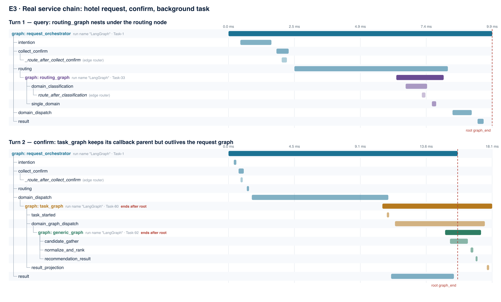
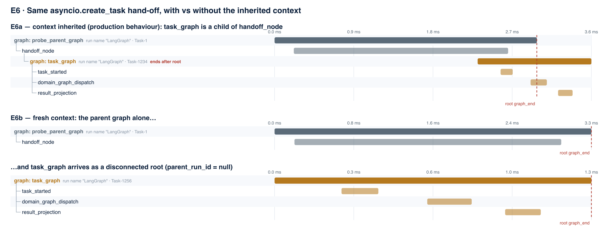
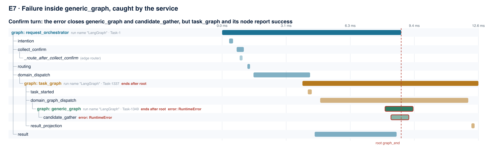
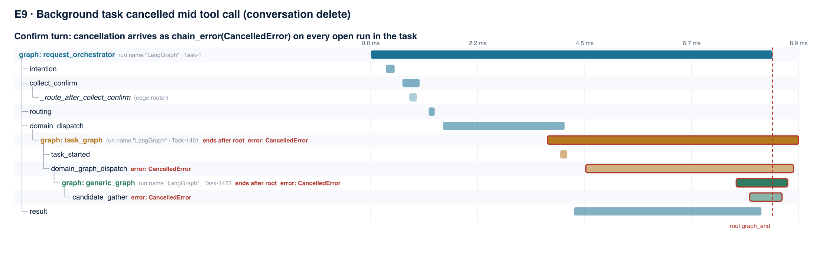

# WP8 Runtime Parentage Probe — Progress Report

**Date:** 2026-10-04 · **Branch:** `WP8-LangGraph-Recommendation-Trace` · **Commit:** `9c09346`
**Environment:** Python 3.11.5 · `langgraph==1.1.10` · `langchain-core==1.6.1`
**Scope:** WP8 D0 (system understanding and baseline). Research questions 1 and 4.

---

## 1. Summary

Until now, every WP8 claim about how MetaRec's five LangGraph graphs relate to
each other came from **reading the code**. This report covers the first
**runtime** check: the real graphs were run through test fixtures that
already existed, while a passive listener recorded every lifecycle event
LangChain's callback system produces. No production code was changed.

Twelve experiments (816 events) covered normal requests, a background task,
the itinerary-anchor path, ten concurrent requests, a caught failure, an
uncaught failure, cancellation, a request timeout, and a multi-domain request.

The headline results:

1. **The parent links are complete and consistent.** Across all 12
   experiments there were 0 references to unknown parents, 0 cycles and 0
   runs that started without ending — including under failure, cancellation
   and timeout. Ten concurrent requests never borrowed each other's parents.
2. **One earlier claim of ours was wrong.** We had stated that the parent
   link breaks when work moves to the background task (`asyncio.create_task`).
   It does not: the background task keeps the `domain_dispatch` node as its
   parent. What actually happens is that it **outlives** that parent, and the
   link survives only **by accident** of how Python copies context (a
   controlled variant without that context produced an orphan).
3. **Callbacks see graphs and nodes, but not tools or LLMs.** Graph and node
   lifecycles were 100% visible; tool and LLM calls produced 0 events, even
   while they were the thing being cancelled or timed out.
4. **The callback data is missing things WP8 needs.** Every graph reports the
   same name (`"LangGraph"`), background runs carry the conversation's
   `thread_id` rather than their own, cancellation arrives labelled as an
   error, and failures that the service catches look like success one level up.

The findings are now locked in by **12 new `runtime_contract` tests**, which
pass consistently (8/8 repeated runs), and the full backend suite is still
green (610 passed, 14 skipped).

---

## 2. What we believed before (the theoretical baseline)

These were the working assumptions before this probe. `WP8_README.md` and
`WP8_RESEARCH_QUESTIONS.md` are the WP8 proposal and research brief (kept
with the project's planning documents, not in this repo);
`GRAPH_EXECUTION_FLOW.md` is [../GRAPH_EXECUTION_FLOW.md](../GRAPH_EXECUTION_FLOW.md),
whose 2026-09-20 version was written from code reading alone.

| # | Prior claim | Source |
|---|---|---|
| T1 | Five production `ainvoke` sites; three runners (`routing_graph`, `generic_graph`, `restaurant_graph`) pass no config, so they need config plumbing before they can be traced | `WP8_README.md` invocation inventory |
| T2 | The graphs are not subgraphs; LangGraph's subgraph machinery "will not link them… looking for it is a dead end" | `WP8_README.md` |
| T3 | `routing_graph` runs inside an orchestrator node and has a real parent node run | `WP8_README.md` |
| T4 | `restaurant_graph` and `generic_graph` are "siblings beneath the task, not children of any node run" | original `WP8_README.md` (code-corrected 2026-09-20) |
| T5 | The callback chain breaks at `asyncio.create_task`; `task_graph` arrives with `parent_run_id = null` | our `GRAPH_EXECUTION_FLOW.md` / progress update, 2026-09-20 |
| T6 | Implicit task-local context alone is not sufficient for propagation (Invariant 2) | `WP8_README.md` |
| T7 | Tool dispatch and LLM calls are raw Python, not LangChain Runnables, so they fire no native callbacks | `GRAPH_EXECUTION_FLOW.md` §2.4–2.5 |
| T8 | A terminal `error` uses the same `run_id` as the failed lifecycle | `WP8_README.md` event contract |
| T9 | Cancellation must be distinguishable from ordinary error | `WP8_README.md`, `WP8_RESEARCH_QUESTIONS.md` |
| T10 | A crash or cancellation can leave starts without ends, to be shown as `incomplete` | `WP8_README.md` |
| T11 | `sequence` is an ordering cursor, not causality | `WP8_README.md` |
| T12 | Instrumentation must not change business behaviour (one execution) | `WP8_README.md` Invariant 1 |

None of these had been tested against a running system.

---

## 3. What was tested

### Method

- **Listener:** a `BaseCallbackHandler` attached through LangChain's
  `register_configure_hook`, bound to a contextvar. It records only lifecycle
  identity: event type, `run_id`, `parent_run_id`, run name, monotonic time,
  asyncio task, and five metadata keys. No inputs, outputs or prompts.
- **No production changes.** `git status` shows only new files.
- **Existing fixtures only:** `conftest.make_service` (the real
  `MetaRecService` with a scripted fake LLM and an in-memory checkpointer),
  the fake hotel/attraction/restaurant tool registries from
  `test_generic_graph.py` and `test_restaurant_graph.py`, and the hotel and
  itinerary-anchor flows from `test_routing_graph.py`. Network-free.
- **Fault injection:** failures injected by temporarily replacing one internal
  function (`_rank_items`, `_explicit_query_domains`); cancellation through the
  real production path (`cancel_conversation_tasks_async`, used when a
  conversation is deleted); timeout via `asyncio.wait_for` around a request
  whose fake LLM never answers.
- **Deterministic ordering:** fake tools wait on a gate that opens only after
  the confirm request has returned, so "the task outlives the request" is
  guaranteed, not a timing accident.

### Experiment matrix

| # | Experiment | Condition | README fixture category |
|---|---|---|---|
| E1 | `routing_graph` alone | Normal, as root | simple branch |
| E2 | `restaurant_graph` alone | Normal, as root | simple branch |
| E3 | Hotel query → confirm → background task | Normal, full service chain | nested graph |
| E4 | Itinerary query, anchor not geocodable | Nested call before any task | nested graph |
| E5 | E3 × 10 at once | Concurrency | concurrency (target 50) |
| E6a | `asyncio.create_task` hand-off, context inherited | Control | — |
| E6b | Same hand-off, fresh context | Fragility | — |
| E7 | Fault inside `generic_graph`, caught by service | Failure (handled) | exception |
| E8 | Fault inside `routing_graph`, not caught | Failure (unhandled) | exception |
| E9 | Background task cancelled mid tool call | Cancellation | cancellation |
| E10 | Chat request times out waiting on the LLM | Timeout | timeout |
| E11 | Hotel + attraction request | Repeated graph under one node | repeated node |

Not covered: parallel nodes (none of the five graphs has parallel branches,
so this needs a synthetic fixture), truncation and process-restart recovery
(collector/storage behaviour — there is no collector yet), and the
100-pair overhead benchmark.

---

## 4. Results

| # | Graph instances observed (parent) | Errors | Outcome |
|---|---|---|---|
| E1 | `routing_graph` (root) | — | route = hotel |
| E2 | `restaurant_graph` (root) | — | 1 restaurant |
| E3 | `routing_graph` (routing node); `task_graph` (domain_dispatch node, **ends after root**); `generic_graph` (domain_graph_dispatch node) | — | task completed, 2 items |
| E4 | `routing_graph` (routing); `generic_graph` (**domain_dispatch**, no task) | — | confirmation |
| E5 | as E3, × 10 | — | 10/10 completed, **0 cross-request leaks** |
| E6a | `task_graph` (handoff_node, ends after root) | — | completed |
| E6b | `task_graph` (**no parent — orphan root**) | — | completed |
| E7 | as E3 | `candidate_gather`, `generic_graph`: RuntimeError | task **completed**, 0 items |
| E8 | `routing_graph` (routing) | `domain_classification` → `routing_graph` → `routing` → `request_orchestrator`: RuntimeError | exception reached caller |
| E9 | as E3 | `candidate_gather` → `generic_graph` → `domain_graph_dispatch` → `task_graph`: **CancelledError** | task cancelled; request unaffected |
| E10 | `request_orchestrator` (root) | `intention`, `request_orchestrator`: **CancelledError** | caller got TimeoutError |
| E11 | `task_graph` (domain_dispatch); **two** `generic_graph` (same domain_graph_dispatch run, one after another) | — | 4 items (2 hotel, 2 attraction) |

**All experiments:** 816 events · 0 dangling parents · 0 cycles · 0 unmatched
starts · 0 tool/LLM events · every graph named `"LangGraph"`.
**Listener on vs off (E3):** 3 vs 3 tool calls, identical items.

### Figures

Each figure is drawn from the recorded events: indentation is the observed
parent link, bars are real start/end times, the red dashed line is where the
request's root graph ended, and red outlines are runs that closed with an error.

**Figure 1 — E3, the full chain.** The background task keeps its parent but runs past the root.



**Figure 2 — E6, the fragility pair.** Same code; only the inherited context differs.



**Figure 3 — E7, a caught failure.** The trace shows the error; the task above it reports success.



**Figure 4 — E9, cancellation.** Every open run in the task closes with `CancelledError`.



Further figures: [E4 itinerary anchor](figures/E4_itinerary_anchor.png) ·
[E8 uncaught failure](figures/E8_routing_failure_uncaught.png) ·
[E10 timeout](figures/E10_request_timeout.png) ·
[E11 multi-domain](figures/E11_multi_domain_siblings.png)

---

## 5. Analysis

### 5.1 How the parent link actually travels

LangChain keeps the active config — including the open callback run — in a
contextvar (`var_child_runnable_config`), and `ensure_config` uses it as the
base for every invocation. An explicit config only overrides the keys it
sets. Consequences seen in the data:

- The three runners that pass **no config** were still traced and correctly
  nested (E3, E4, E11). T1's premise that they are "untraceable until
  plumbed" is wrong for today's call sites; they are traceable **implicitly**.
- Because they inherit the calling node's whole config, LangGraph also gives
  them nested checkpoint namespaces (`routing:<id>`,
  `domain_graph_dispatch:<id>|candidate_gather:<id>`) — subgraph-like
  behaviour T2 said would not happen.
- `task_graph` passes its own `configurable`, so it keeps the callback parent
  but gets its **own root** checkpoint namespace. For this one graph, the
  callback tree says "child" and the checkpoint namespace says "root".

### 5.2 The background-task boundary

This is the most important boundary in the system, and the one our earlier
analysis got wrong.

- **The link holds** (E3, E5 ×10, E6a): `asyncio.create_task` copies the
  current contextvars, so `task_graph`'s parent is the `domain_dispatch` run.
- **But the child outlives its parent.** In every run, the request graph
  finished before the task did. If WP8 marks a trace complete when the root
  ends, it will cut off the actual recommendation work.
- **And the link is fragile.** E6b changes nothing except giving the new task
  a fresh context, and `task_graph` becomes an orphan root. Any future move to
  a worker queue, separate process, thread pool, or resume-after-restart would
  break every task trace silently. This turns Invariant 2 (T6) from a design
  principle into a measured requirement.
- **Interleaving confirms T11.** The task runs on a different asyncio task and
  overlaps the request graph's final `result` node, so event order cannot be
  read as cause and effect; only the parent links can.

### 5.3 Failure behaviour (E7, E8)

- Errors close the **same** `run_id` that started (T8 confirmed natively) and
  propagate innermost-first through every enclosing run (E8: four levels).
- **A failure the service catches stops being visible one level up.** In E7,
  `generic_graph` closes with `RuntimeError`, but `domain_graph_dispatch` and
  `task_graph` close as successful, and the task's business status is
  `completed` with zero items. The trace is more truthful than the task status
  — but only if WP8 surfaces nested errors rather than summarising by the
  root's status.
- An uncaught routing failure (E8) fails the whole chat request — a product
  behaviour, not a tracing one, but worth noting for the report.

### 5.4 Cancellation and timeout (E9, E10)

- Both arrive as `chain_error` with error class `CancelledError`, on every run
  that was open at the time. No run was left without an end.
- So T9 is only **partly** met by the framework: callbacks do not have a
  separate "cancelled" event. WP8 must map `CancelledError` to status
  `cancelled` itself; otherwise cancellations will be shown as failures.
- T10 (unmatched starts after a crash) could not be observed: in-process
  cancellation and timeout close everything cleanly. The unmatched-start case
  only arises if the process dies, which needs the restart fixture.
- In E10 the request was cancelled while it waited on the LLM, but the LLM call
  itself produced no event. The trace shows the `intention` node was
  cancelled, not why it was slow.

### 5.5 Repeated graphs (E11)

The multi-domain request ran two instances of the same graph definition under
the same node run, one after another. They are distinguishable only by
`run_id`. WP8's `graph_instance_id` and definition-level diff (invocation count
= 2) are needed exactly for this case; it is not hypothetical.

### 5.6 Concurrency (E5)

Ten simultaneous end-to-end requests produced 10 task graphs, each attached to
its own request, with no shared or swapped parents. This is early support for
the README's 50-concurrent-run acceptance criterion; it is not yet that test.

### 5.7 What callbacks can and cannot see (research question 4)

| Kind of operation | Visible via native callbacks |
|---|---|
| Graph start/end, node start/end, conditional-edge routers | Yes (100% in all runs) |
| Tool calls (`registry.dispatch` in a worker thread) | **No** (0 events) |
| LLM calls (raw SDK, including the restaurant planner) | **No** (0 events) |

T7 is confirmed. Tool and LLM visibility depends entirely on the WP5/WP7
adapter sink.

### 5.8 Gaps in the callback data WP8 must fill

- **No graph identity:** all five graphs are named `"LangGraph"`; the probe had
  to infer which graph ran from its first node.
- **Wrong inherited identity:** background runs carry the conversation
  `thread_id` and the parent's checkpoint namespace.
- **Routers look like runs:** `_route_after_collect_confirm` and
  `route_after_classification` appear as child runs of nodes and must not be
  counted as node visits.

### 5.9 Behaviour neutrality

With the listener attached vs detached, the same request made the same tool
calls and returned the same items (T12 supported, n = 1). This tests the
listener, not the future collector, and is not the 100-pair benchmark.

### 5.10 Limits of this evidence

- **Fakes, not real providers.** Timings are milliseconds; real tool and LLM
  calls take seconds, which would widen the "outlives the root" gap, not
  remove it.
- **The listener uses the implicit context mechanism under study.** The
  explicit-config path WP8 will build is not exercised yet.
- **Faults were injected** by temporarily replacing internal functions. They
  show how failures propagate, not how often they occur.
- **Small n:** concurrency 10 (target 50), neutrality 1 (target 100 pairs).
- **One process, one interpreter version.** No restart, crash or multi-worker
  deployment.

---

## 6. What changed relative to the theoretical baseline

| # | Prior claim | Runtime finding | Verdict |
|---|---|---|---|
| T1 | No-config runners need plumbing before tracing | Traced implicitly via inherited context (E3, E4, E11); plumbing still needed to make it explicit | **Refined** |
| T2 | Subgraph machinery won't link them | No-config graphs get subgraph-style checkpoint namespaces; `task_graph` does not | **Partly overturned** |
| T3 | `routing_graph` has a real node parent | Parent = routing node in every run | **Confirmed** |
| T4 | Domain graphs never have a node parent | Parent = `domain_dispatch` (E4) or `domain_graph_dispatch` (E3, E11) | **Overturned** |
| T5 | Chain breaks at `asyncio.create_task` | Parent kept (E3, E5, E6a); breaks only with a fresh context (E6b); child outlives parent | **Overturned** |
| T6 | Implicit context is not sufficient | E6b demonstrates the failure mode concretely | **Confirmed, now evidenced** |
| T7 | Tools/LLMs fire no native callbacks | 0 events across 816 | **Confirmed** |
| T8 | Error reuses the lifecycle's `run_id` | Native behaviour (E7–E10) | **Confirmed** |
| T9 | Cancellation distinguishable from error | Only by exception class; callbacks report both as `chain_error` | **Refined** |
| T10 | Cancellation/crash may leave unmatched starts | In-process cancel/timeout leave none; crash untested | **Refined** |
| T11 | Sequence is not causality | Background task interleaves with the parent's last node | **Confirmed** |
| T12 | Observation must not change behaviour | Same tool calls and items on vs off (n = 1) | **Supported** |
| — | *(not previously stated)* | Child outlives the root; all graphs named `"LangGraph"`; inherited `thread_id` is the conversation's; routers appear as runs; caught errors invisible one level up | **New** |

The corrected call map is in [../GRAPH_EXECUTION_FLOW.md](../GRAPH_EXECUTION_FLOW.md) §3.

**The methodological point for the report:** reading the code predicted the
structure correctly, but got the most important boundary wrong, because
parentage depends on how Python schedules and copies context at runtime.
Research question 1 is a runtime question and needs runtime evidence.

---

## 7. Implications for WP8 design (D1–D2)

| Finding | Design consequence |
|---|---|
| Child outlives root (E3, E5) | A trace is `completed` only when every open lifecycle has closed; root end ≠ trace end |
| Link is implicit (E6b) | Pass trace context explicitly through `create_task_async` → `run_task_graph`; acceptance test: E6b must still link |
| All graphs named `"LangGraph"` | The invocation helper sets a run name and `graph_definition_id` per graph |
| Inherited `thread_id` is wrong | Never derive identity from inherited callback metadata; stamp WP8's own `graph_instance_id` / `task_id` |
| Cancellation = `chain_error(CancelledError)` (E9, E10) | Map exception class → `cancelled` vs `error` |
| Caught errors hidden one level up (E7) | Surface nested error counts on ancestors; do not summarise a run by its own status alone |
| Routers appear as runs | Record as edge evaluations, not node visits |
| Repeated instances under one node (E11) | `graph_instance_id` per run; diff counts invocations |
| 0 tool/LLM events | Define the WP5/WP7 adapter-sink interface with fakes now |

---

## 8. Tests added

`tests/test_wp8_parentage_baseline.py` (marker `runtime_contract`), backed by
`tests/wp8_probe_support.py` — the same code the CLI probe runs, so the
published evidence and the asserted behaviour cannot drift apart. Every test
also asserts 0 dangling parents, 0 cycles and 0 unmatched starts.

| Test | Guards |
|---|---|
| `test_nested_routing_graph_has_routing_node_parent` | T3 |
| `test_background_task_graph_keeps_parent_but_outlives_request_graph` | T5 correction; outlives-root |
| `test_itinerary_anchor_nests_generic_graph_under_domain_dispatch` | T4 correction |
| `test_concurrent_requests_keep_their_own_parents` | No cross-request leakage (n = 10) |
| `test_task_handoff_parent_depends_on_inherited_context` | Fragility (E6a vs E6b) — **expected to change** when explicit propagation lands |
| `test_failure_inside_domain_graph_is_contained_by_service` | Caught-failure semantics |
| `test_uncaught_routing_failure_errors_every_enclosing_run` | Error propagation order |
| `test_background_cancellation_closes_runs_with_cancelled_error` | Cancellation semantics |
| `test_request_timeout_closes_root_with_cancelled_error` | Timeout semantics |
| `test_multi_domain_runs_sibling_domain_graphs_under_one_node` | Repeated instances |
| `test_callback_data_gaps_wp8_must_fill` | Naming, tool/LLM invisibility, inherited `thread_id` |
| `test_listener_does_not_change_business_behaviour` | T12 (n = 1) |

**Results:** 12 passed in ~1.6 s; 8/8 identical repeated runs; full backend
suite 610 passed, 14 skipped (existing Postgres-only tests).

Several of these tests **characterise today's behaviour** (orphaning under a
fresh context, the `"LangGraph"` name, the inherited `thread_id`). When WP8
fixes those gaps the tests should be updated deliberately — that is the point:
the change becomes visible and reviewed rather than silent.

```bash
cd MetaRec-backend
../.venv/bin/python -m pytest -q -m runtime_contract tests/test_wp8_parentage_baseline.py
```

---

## 9. Still open

- **Parallel nodes** — needs a synthetic fixture; no production graph branches in parallel.
- **Process crash / restart** — the only route to unmatched starts and `incomplete` traces.
- **Scale** — 50 concurrent traces, 100 paired overhead runs.
- **Explicit propagation** — once built, re-run E6b expecting a linked parent.
- **Real providers** — an opt-in smoke run to confirm the "outlives the root" gap at realistic timings.
- **Itinerary task gathering** — attraction + restaurant + hotel under one node goes through the protected itinerary pipeline; E11 covers the same pattern on the multi-domain path.

---

## 10. Files and reproduction

| File | Contents |
|---|---|
| `REPORT.md` | This report |
| [`METHOD.md`](METHOD.md) | Method, experiment list, how to regenerate data and figures |
| `data/E*.events.json` | Raw recorded events per experiment |
| `data/summary.json` | Per-experiment graph tables, errors, integrity, concurrency, exactly-once |
| `figures/E*.png` | Figures |
| [`scripts/wp8_parentage_probe.py`](../../../scripts/wp8_parentage_probe.py) | CLI that regenerates `data/` |
| [`scripts/wp8_trace_waterfall.py`](../../../scripts/wp8_trace_waterfall.py) | Figure renderer |
| [`tests/wp8_probe_support.py`](../../../tests/wp8_probe_support.py) | Shared listener, experiments and analysis |
| [`tests/test_wp8_parentage_baseline.py`](../../../tests/test_wp8_parentage_baseline.py) | The 12 tests |

```bash
cd MetaRec-backend
../.venv/bin/python scripts/wp8_parentage_probe.py --out docs/wp8/parentage-baseline/data
```

`run_id`s and millisecond timings change between runs; parent relationships,
error chains, integrity counts and the leak count do not.
