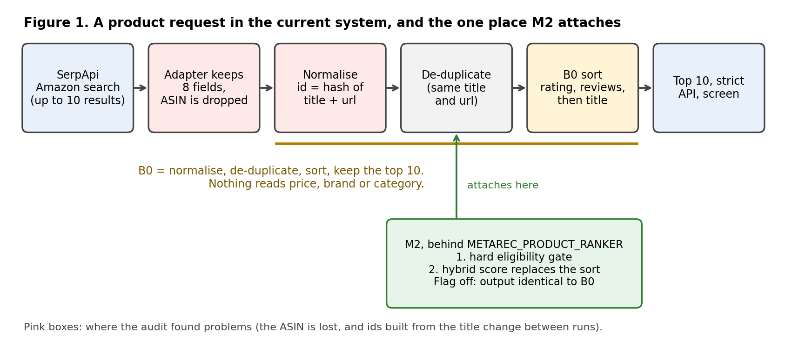
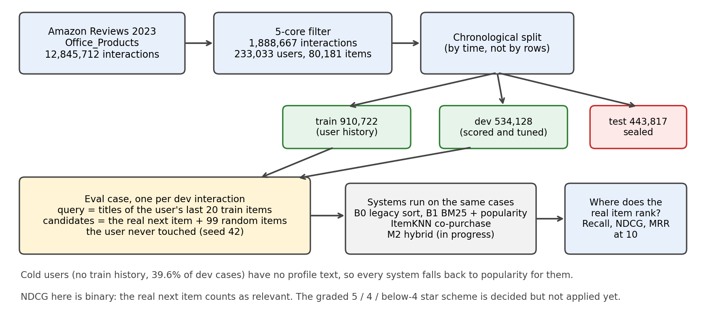
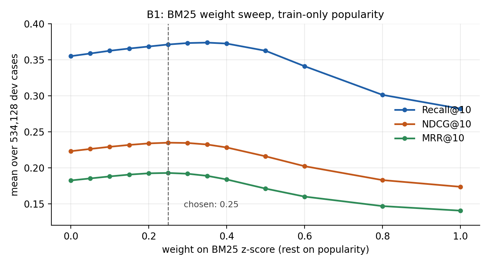

# WP4 · Interim Report

Ong Chuan Hau (C240087) · MetaRec `feat/wp4-constraint-aware-product` · base commit `9c09346` · status as of 21 October 2026

**Objective.** WP4 makes MetaRec's product recommendations respect what the user asked for (budget, brand, category, compatibility) while ranking the remaining products by relevance. The target is a ranker, M2, that is shown offline to do better than the current sort (B0) and than a text-plus-popularity baseline (B1), with a point estimate of at least 3% relative NDCG@10 (Project Plan §6), and that leaves the live output identical to B0 when its feature flag is off. The evidence comes from a frozen Amazon Reviews 2023 dataset [1], a development split used for tuning, and a sealed test split opened once at the end.

This report covers the D0 audit in full (sections 1 to 4), then what has been built since: the frozen dataset (D1, section 5), the baselines (D2, section 6) and the M2 ranker (D3, section 7). Section 8 lists what is still open and what comes next.

D0 scope (proposal): *trace router → product tool parameters → providers/enrichment
→ normalisation/deduplication → generic rank → strict API/UI; reproduce B0; audit
item feedback, IDs, prices and missing fields; freeze contracts, dataset/category,
split and constraint fixtures.*

## Progress at a glance

| deliverable | status | where |
|---|---|---|
| D0 audit and B0 | **done** | sections 1 to 4; 15 frozen fixtures and golden files in `tests/wp4/` |
| D1 data and features | **done**, including the star ratings, leak-free item features and a complete data sheet | section 5; `docs/wp4/D1-data-sheet.md` |
| D2 baselines | **done** on development data; a popularity leak was found and the numbers re-run; confidence intervals, weight sweep and leak-free legacy B0 added (section 6) | section 6; `scripts/wp4_build_eval_cases.py`, `scripts/wp4_run_baselines.py`, `scripts/wp4_sweep_ranks.py` |
| D3 M2 ranker | **done**: built, re-tuned with train-only popularity, tested (63 WP4 tests pass), ranker-only p95 11 to 19 ms against the 25 ms limit; on held-out users M2 beats B1 by +0.81% NDCG@10 (95% interval +0.69% to +0.94%), short of the 3% target, but +2.91% on the long-history slice (section 7.2) | section 7; `langgraph_metarec/product_ranker_m2.py`, `scripts/wp4_m2_*.py` |
| D4 integration | not started (the hard-constraint gate already sits behind the flag) | section 8 |
| D5 evaluation | not started; the sealed test split has not been scored | section 8 |

---

## 1. Pipeline trace (a product request, end to end)



| # | stage | code | what happens for `domain = product` |
|---|---|---|---|
| 1 | HTTP | `main.py` `POST /api/process` | one endpoint: intent analysis, preference extraction, HITL confirm, routing, task creation |
| 2 | intent + preferences | `service.py` (LLM) | free-text query → structured `preferences`; user confirms before search (`hitl_state`) |
| 3 | routing | `langgraph_metarec/graphs/routing_graph.py` `run_routing_graph` | product route chosen by keyword classification **or** a preference frame carrying `brand`/`category` (`_DOMAIN_ENTITY_KEYS["product"]`). Emits `DomainRoute(domain="product", execution_domain="product", status="ready", tool_tags=["#thing","#shopping","#product"])` |
| 4 | task dispatch | `langgraph_metarec/graphs/task_graph.py` → `service.py` `_execute_generic_domain_task` | preferences fused as `{**profile_domain_slice, **request_preferences}` |
| 5 | product preference normalisation | `request_orchestrator.py` `_normalize_product_preferences` | regex fills `product`, `brand`, `category`, `use_case`, `model`, `budget`. **`budget` is a text string** (`"<= 120 USD"`, `"120 USD"`, `"affordable"`). No structured budget, no required attributes, no brand exclusions. |
| 6 | candidate gather | `generic_graph.py` `candidate_gather` | `ToolRegistry.resolve(domain="product", tags=[...])` → `amazon.product.search` (active only if `SERPAPI_KEY` set). Seed pass: `_parameters_for_tool` → `_product_search_query(query, prefs)` concatenates the query with budget-text / category / brand / use_case / model tokens into **one search string** → `{"query": <string>, "max_results": 10}`. ReAct refine loop: `amazon.product.search` is not in `_RELAX_ORDER`, so no relaxation happens — the loop just stops. |
| 7 | provider | `tool_registry.py` `_amazon_product_search_adapter` | SerpApi `engine=amazon`, `k=<query string>`. From each `organic_results[:10]` keeps **only** `{title, brand, link, rating, reviews, price, thumbnail, source}`. Then `compact_tool_output` caps free text. |
| 8 | enrichment | — | **none for products.** (Places get gmap/osm merge; products do not.) |
| 9 | normalisation | `generic_graph.py` `normalize_tool_items` (amazon branch) → `_item()` | `title`←title · `subtitle`←`brand or price` · `image_url`←thumbnail · `url`←link · `rating` · `reviews_count`←reviews · `source`="Amazon" · `tags`←`[brand?, price?]` · `why`="Matched the product search query." · `id` ← `raw.product_id or raw.asin` **→ always empty** (step 7 drops both) → falls back to `"product_" + sha1(tool\|title\|url)[:16]` |
| 10 | dedup | `generic_graph.py` `_rank_items` → `_same_recommendation` | non-place items merge when canonical title matches **and** (same `url`, or — if neither has a url — same canonical `subtitle`). Merge keeps the higher-scored copy. |
| 11 | **generic rank (B0)** | `generic_graph.py` `_item_score` | sort key = `(rating or 0, reviews_count or 0, raw.popularity or 0, title)`, descending. **No price, budget, brand, or category term anywhere.** `[:10]`. |
| 11a | *(WP4 M2 gate)* | `generic_graph.py` + `product_constraints.py` | hooked here, **behind `METAREC_PRODUCT_RANKER` (default `legacy` = no-op)** |
| 12 | result object | `service.py` `_execute_generic_domain_task` | `RecommendationResult(items=[RecommendationItem(**item) …], confidence_score=0.85 if items else 0.45)` |
| 13 | strict API / UI | `RecommendationItemAPI` (`StrictBaseModel`) | exposes `id, domain, title, subtitle, description, image_url, url, rating, reviews_count, source, tags, why, gps_coordinates`. The internal `raw` payload is **deliberately stripped** (`_client_safe_item`). |
| 14 | persistence + feedback | `_persist_recommendation_result` → `result_id`; `internal/item_interactions/` behind `POST /api/item-interactions` | logs `(user_id, domain, item_id, action)`; projected to `ItemInteractionV1` |

### B0 definition (frozen)

**B0 = `_rank_items(normalize_tool_items("amazon.product.search", <serpapi output>, "product"))[:10]`** — steps 9–11 with the M2 flag off. Nothing between the provider and the strict API touches price or any stated constraint.

### Where the result reaches the screen (frontend)

- `MetaRec-ui/src/ui/Chat.tsx`, `GenericItemsSection` renders items **in the order received**. There is no client-side sorting, so the ranker's order is exactly what the user sees and a ranking change needs no UI change.
- Each card shows the image, title, domain badge, `subtitle`, rating, review count, source, up to 8 `tags`, `description`, `why`, and a "View source" link (`url`).
- **There is no price field on the card.** For products, price reaches the screen only as text: as the `subtitle` when the brand is empty (91 % of candidates) and again as a tag chip. The strict API has no numeric price or currency field, and the proposal adds none.
- The `why` line is the only free-text explanation slot. Today it always reads "Matched the product search query."
- The Save / Not interested / Purchased chips (`ItemInteractionControls.tsx`) appear for registered users only. Each chip posts `item_id = item.id`, the title-hashed id from section 3.1, plus a small snapshot (`title`, `subtitle`, `source`, `url`).
- On load, each card fetches existing interactions for the ids on screen (`listItemInteractions`, keyed by item id). By code reading, if a product's id changes between searches its earlier "Saved" state would not show. This has not been observed live.
- Because the snapshot stores `url` and the ASIN sits inside the url, stored interactions could be re-keyed to ASIN offline if the id scheme changes.

---

## 2. B0 reproduction

`python -m tests.wp4.eval_constraints --baseline` ranks the frozen candidate pools with `_rank_items` directly (no network) and counts labelled violators in the top-10.

| metric | B0 |
|---|---|
| labelled hard-constraint violators surfaced | **52 / 52 (100 %)** |
| cases with a violator at rank 1 | 6 / 15 |
| cases with a violator in the top 3 | 9 / 15 |

**How to read the 100 %.** It is true by construction and should not be quoted as a finding. Each pool holds at most 10 products, B0 shows the top 10, and B0 removes nothing, so every violating product necessarily reaches the user. The evidence that matters is different: 52 of the 146 products (36 %) that the provider returned break the user's own stated constraints, and in 9 of 15 queries a violating product ranks in the top 3 (rank 1 in 6). The labels behind these counts were assigned by applying each query's stated constraints to the returned titles and prices; they are a judgment and should be spot-checked against the case files in `tests/wp4/cases/`. The per-search summary (including the `pool_viol` and `leaked` columns of the evaluation script) and the full list of all 52 are in Appendix B.

Cause: `_item_score` rewards rating + review count, so a well-reviewed item that is 55 % over budget (or the wrong category, or an excluded brand) outranks cheaper compliant items. This is the exact failure the proposal's acceptance criterion 2 targets.

B0 is also frozen at the **strict-API level**, which is what acceptance criterion 1 compares against. `tests/wp4/golden/*.json` holds, for each of the 15 cases, the exact items a client would receive today: the internal `raw` payload removed the way `main._client_safe_item` does it, and every item validated against `RecommendationItemAPI`. `tests/wp4/test_b0_golden.py` checks that with the ranker flag unset or `legacy` the output equals those files, and that switching the ranker on changes at least one of them, so the fixtures are able to detect a change. Regenerate them only if B0 is meant to change: `python -m tests.wp4.freeze_b0`.

---

## 3. Audit

### 3.1 IDs: derived from title and link, and the title changes between runs

The strict-API `id` for a product is `"product_" + sha1("amazon.product.search|" + title + "|" + link)[:16]`.

- The SerpApi Amazon result carries an ASIN, but `_amazon_product_search_adapter` does not keep it, so `raw.product_id` / `raw.asin` are always absent and the hash is always used.
- **The ASIN is recoverable anyway.** All 140 captured links contain `/dp/<ASIN>` (`python -m tests.wp4.audit_candidates`).
- **Measured stability** (`python -m tests.wp4.recheck_stability`, three queries re-run live on 18 Sep 2026, 12 products present in both runs): the link never changed (0 of 12), but the title changed for 4 of 12 (33 %). Because the id hashes the title, about one product in three would get a different id on a repeat search. An ASIN-based id would have been identical for 12 of 12.
- The item-interaction seam keys on this `item_id`, so an item a user saved or hid could fail to match on a later search. That follows from the measurement above; it has not been observed end to end.
- The sample is small (3 queries), so read 33 % as an indication rather than a rate.
- **Action needed, still outstanding:** derive the ASIN from the link (or keep it from the provider) and use it as `item_id`, with the hash only as a fallback. Project Plan §6 ("ASIN scope") records this as in scope, as an additive change to `_amazon_product_search_adapter`. D1 froze a research dataset that already carries `parent_asin` and never touched the live adapter, so this is still unbuilt. It belongs to D4 integration, because the adapter is production code.

### 3.2 Prices: display strings with a currency symbol, 2 % missing, and they move between runs

- Present for 137 of 140 candidates (98 %); the 3 missing come from two queries. All 137 parse to a number and all use the `$` symbol. No ranges (`"$a - $b"`) appeared in this sample, although `product_constraints.parse_price` handles them.
- There is no currency field, so currency is inferred from the symbol. `$` is ambiguous: the app treats `$` as SGD elsewhere, while SerpApi Amazon returns USD.
- **Prices move between runs.** Of the 12 products seen in both runs, the price changed for 7 (58 %), for example $118.99 to $139.99 and $49.99 to $39.99. A budget constraint could pass on one run and fail on the next, so evaluation has to run on frozen snapshots rather than live calls.
- **A policy has since been decided, and built in the M2 module only.** Project Plan §6 ("Missing price policy") records: unknown price is never treated as zero; when the request states a budget, strict mode excludes the item under a new `UNKNOWN_PRICE_STRICT_MODE` reason code; with no budget stated, the item is kept and flagged. At the time of this audit that reason code existed only in planning documents — a repo-wide search found it nowhere in actual code. The live `product_constraints.violations()` check (`if price is not None and price > c.budget_max`) still silently skips unknown-price items with no reason code and no distinction for whether a budget was even stated. Since then the policy has been implemented and tested in the M2 module (section 7.3); applying it in the live path is part of D4.

### 3.3 Missing and unreliable fields (measured over 140 live candidates)

The 140 are the 14 directly captured case files. `case_01` was transcribed from a log and is incomplete (6 candidates), so it is left out of this field count to avoid skewing the percentages; it is included in the 146 candidates used for the B0 violation count in section 2.

| field | present |
|---|---|
| `title`, `rating`, `reviews`, `link`, `thumbnail` | 140 / 140 (100 %) |
| `price` | 137 / 140 (98 %) |
| `brand` | 12 / 140 (9 %). Populated in only 2 of 14 queries, the two whose query named a brand (Sony, Logitech); empty for all others |
| category / `type` | never. No candidate carries such a field |
| `asin` | not returned as a field, but present in the link for 140 / 140 |

Two further findings from the live re-run. Only 12 of 30 items (40 %) appeared in both the frozen and the re-run result for the same query, and the relative order of the shared items differed in all three queries. Live retrieval is therefore not repeatable, which is why B0 has to be reproduced from frozen candidate snapshots (acceptance criterion 1 requires no network).

Category and brand constraints can therefore only be checked against the title on live data today. D1 checked the Amazon Reviews 2023 metadata as a better source: across its 80,181 items the brand is missing for 6.2%, the category list for 3.6% and the main category for 1.2%, against 91% and 100% missing in the live captures.

### 3.4 Item feedback seam

- `POST /api/item-interactions` (`internal/item_interactions/`), auth-session required, guests rejected in-endpoint.
- Actions: `save`, `hide` (stateful toggles, one active row per `(user, domain, item)`; save un-hides, hide un-saves), `positive`, `negative`, `consumed` (append-only). Product `consumed` label = "Purchased".
- Wire shape `ItemInteractionV1 = {schema_version:"item-interaction.v1", event_id, domain, item_id, action, result_id, occurred_at}` — docstring: *"consumed by the domain rankers and the offline evaluators"*. This is the input for M2's authenticated-user affinity feature.
- Keyed on `(user_id, domain, item_id)` — see the ID-stability caveat in 3.1.

---

## 4. Freeze list

| artefact | status | location |
|---|---|---|
| B0 definition | **frozen** (§1) | `generic_graph._rank_items` @ `9c09346` |
| Strict item contract | **frozen** | `RecommendationItemAPI` (13 fields, no `raw`) |
| OpenAPI contract | **frozen** | `contracts/metarec-openapi.json` |
| Item-interaction contract | **frozen** | `ItemInteractionV1` (`business_models.to_interaction_v1`) |
| Generic-graph metadata shape | **frozen** (+`constraint_filter`) | `generic_graph.recommendation_result` |
| Constraint fixtures | **frozen — 15 cases** | `tests/wp4/cases/*.json` (12 constraint queries + 3 clean controls, 52 labelled violators; case_01 was transcribed from a log, the other 14 are live SerpApi captures) |
| B0 strict-API output | **frozen, 15 golden files** | `tests/wp4/golden/` |
| Ranking dataset (Amazon Reviews 2023 subset) | **frozen** — `Office_Products` (rank 17 of 33 categories by rating count, the literal median; not Electronics), checksummed raw files | `docs/wp4/D1-data-sheet.md` |
| Split (chronological per the proposal) | **frozen** — last 10% of the timeline is the locked test set, the 10% before that is development (80/10/10 by time, not by row count) | `docs/wp4/D1-data-sheet.md` |
| Graded relevance judgements | **created for dev**: 5 stars = 2, 4 stars = 1, below 4 = 0, one label per dev row (Project Plan §6); used for the graded NDCG in sections 6.4 and 7.1 | `data/wp4/processed/split/dev_graded_relevance.tsv` |
| Development eval cases | **frozen by checksum**: 534,128 cases (about 1 GB), rebuilt from scratch and byte-identical; candidates are stored as ASINs only | `scripts/wp4_build_eval_cases.py`, seed 42, `eval/checksums.sha256` |
| Test split (443,817 rows) | **sealed**: not scored, not used to tune anything | `data/wp4/processed/split/test.tsv` |

---

## 5. D1: the frozen dataset

Full detail and every checksum are in `docs/wp4/D1-data-sheet.md`. The short version:

- **Category.** `Office_Products` from Amazon Reviews 2023. It is rank 17 of 33 categories by rating count, which is the median, and it is not Electronics.
- **5-core filter.** Users and items with fewer than 5 interactions are removed repeatedly until nothing changes, which took 13 passes. 12,845,712 interactions became 1,888,667, covering 233,033 users and 80,181 items.
- **Split by time, not by rows.** The data runs from 1999-08-02 to 2023-09-09. The last 10% of that timeline is the test set (from 2021-04-12), the 10% before it is development (from 2018-11-13), and everything earlier is train. That gives 910,722 train, 534,128 dev and 443,817 test rows. The test set holds 23.5% of the rows rather than 10% because reviews pile up in recent years.
- **Metadata.** All 80,181 items matched a metadata record by `parent_asin`. Price is missing for 26,846 items (33.5%), against 2% in the live SerpApi captures. The first count was 26,686: 160 items carry the text "—" in the price field instead of null, and a null check misses them. The real parser caught it and the report was corrected.
- **Parser.** `scripts/wp4_dataset_parser.py` follows the proposal's contract: identity is the ASIN and never the title, price is a typed amount and currency with provenance, and a missing or failed parse is unknown, never zero. It has 9 unit tests.
- **Star ratings, leak-free features and graded labels.** The first pass dropped the star rating. A second pass re-read the raw reviews and kept it in a new file, checked row for row against the 5-core file, without changing any existing file. From it come per-item counts and mean ratings computed from train rows only (what was knowable at the train cutoff), and a graded relevance label for each dev row (76.1% are 2, 10.4% are 1, 13.5% are 0). 40.3% of items have no train rows yet because they were first reviewed later. All of it was recounted independently with no mismatch.
- **Candidate pools.** The 100-candidate pools used in section 6 are frozen by checksum. Rebuilding all 534,128 cases from scratch gave a byte-identical file.
- **Data sheet.** It now states the licence position (neither the dataset's homepage nor its Hugging Face card gives a licence or terms, only a citation request, so this is flagged to confirm with the supervisor), what personal data is held, minimization, access, retention, deletion and custody of the sealed test set.
- **Reproducibility.** The raw and processed files are not in git. Their SHA-256 checksums, the data sheet and the scripts that produce them are.

## 6. D2: baselines on development data



**How a test case is built.** The frozen data holds interactions and an item catalogue, with no search queries and no candidate lists, so the evaluation cases had to be constructed. These choices are mine; the proposal does not dictate them. Each development interaction becomes one case. "The real next item" in this report means the item of that interaction; a user with several development interactions gets one case for each, all with the same train-only history, and the item of a given case is not necessarily the first one the user bought after the cutoff. The "query" is the titles of the user's last 20 train items (fewer if the user has fewer), oldest first, joined with single spaces. For B1, query and candidate titles are lowercased and split into runs of letters and digits (regular expression `[a-z0-9]+`), so "0.7 mm" becomes `0`, `7`, `mm`. The candidates are the real next item plus 99 random items that user never touched in train, dev or test, so there are 100 candidates, shuffled, drawn with a fixed seed (42). The size of 100 (the real item and `NUM_NEGATIVES = 99` random items) and the history cap of 20 are settings of the case builder `scripts/wp4_build_eval_cases.py`. Ranking the whole catalogue of 80,181 items in each of 534,128 cases would need about 800 times as much scoring; 100 candidates is a common size for sampled evaluation and gives a clear floor, since a random ranking then scores Recall@10 = 0.10. The price is that every value is a sampled metric (see item 5 under "What this changes"). A system is scored on where the real item lands in its ranking. Users with no train history (39.6% of the dev cases) have no profile text, so every system falls back to popularity for them.

**How a case is scored.** A system gives each of the 100 candidates a score and the candidates are sorted from highest to lowest. Let *rank* be the position of the real next item in that order (1 is best). Each case has exactly one relevant item, so the three metrics reduce to:

- **Recall@10** = 1 if rank ≤ 10, otherwise 0. With one relevant item per case this is the same as the hit rate.
- **MRR@10** = 1 / rank if rank ≤ 10, otherwise 0.
- **NDCG@10** [4] = 1 / log2(rank + 1) if rank ≤ 10, otherwise 0. The ideal ranking puts the item at rank 1, which has a gain of 1, so no further normalisation is needed.

| rank of the real item | 1 | 2 | 3 | 5 | 10 | 11 or worse |
|---|---|---|---|---|---|---|
| Recall@10 | 1 | 1 | 1 | 1 | 1 | 0 |
| NDCG@10 | 1.000 | 0.631 | 0.500 | 0.387 | 0.289 | 0 |
| MRR@10 | 1.000 | 0.500 | 0.333 | 0.200 | 0.100 | 0 |

The reported value of each metric is its mean over all 534,128 cases, each case counting once, so a user with many development interactions contributes many cases. If two candidates tie, the sort keeps their order in the stored (shuffled) candidate list. A system that ranked at random would average Recall@10 = 0.10, NDCG@10 = 0.045 and MRR@10 = 0.029, which is the floor to read the results against. These metrics treat the real next item as relevant (gain 1) and every other candidate as not (gain 0). The Project Plan also decides a graded scheme from the star rating in the user's review of that item: 5 stars = 2, 4 stars = 1, below 4 = 0. Because each case has exactly one rated item, NDCG normalised by the ideal ranking is 1 / log2(rank + 1) for any positive grade and 0 for grade 0, so the difference between 2 and 1 cancels out. Graded NDCG@10 therefore equals the binary NDCG@10 with the 13.5% of cases whose real item was rated below 4 stars set to 0 (section 6.4). Keeping 2 and 1 apart would need an unnormalised DCG; that is a decision for the supervisor (section 8). Section 6.1 shows a full case: the real item at rank 71 scores 0 on all three.

**The three baselines**, all run on the same 534,128 cases:

- **B0** is the existing sort: rating, then review count, then title. The popularity term in the real formula is always 0 for Amazon products, so it is left out; the order is the same.
- **B1** scores each of the 100 candidates in a case in three steps, all inside that case. (1) *Text*: Okapi BM25 [2] (`rank_bm25` `BM25Okapi` [5], k1 = 1.5, b = 0.75) between the history text and the candidate's title, where both are lowercased and split into pieces of letters and digits, and the 100 candidate titles are the BM25 corpus (a word that occurs k times in the history counts k times). (2) *Popularity*: ln(1 + number of train reviews of the item). (3) Each of the two lists of 100 scores is turned into a z-score (score minus the list's mean, divided by its population standard deviation), and the final score is 0.25 × text z + 0.75 × popularity z. Candidates are sorted by that score, highest first. Section 6.1 follows two real cases through every number.
- **B0 in the leak-free runs** comes in two forms. The *reviews-only* sort orders by the number of train reviews, then by title (descending); it is the B0 in the main tables of this section. The *legacy order with train-only ratings* orders by the item's mean star rating over train reviews first (0 if it has none), then by train review count, then by title (descending); it is the closest leak-free version of the live sort and is scored in section 6.4.
- **ItemKNN** [3], the collaborative baseline, scores a candidate by its average cosine similarity to the user's history items. The similarity of two items is the number of train users who interacted with both, divided by the square root of the product of their train user counts. Section 6.2 gives the formula and two cases.

First full-set results, with popularity taken from the metadata (this version leaks; see below):

| system | Recall@10 | NDCG@10 | MRR@10 |
|---|---|---|---|
| B0, legacy sort | 0.2144 | 0.1020 | 0.0678 |
| B1, BM25 weight 0.5 (untuned) | 0.4747 | 0.2806 | 0.2213 |
| **B1, BM25 weight 0.25 (tuned)** | **0.5140** | **0.3217** | **0.2624** |
| ItemKNN | 0.3369 | 0.2068 | 0.1668 |

By slice, Recall@10 for warm users is 0.2005 (B0), 0.5105 (B1) and 0.2172 (ItemKNN). For cold users it is 0.2355 (B0) and 0.5192 for both B1 and ItemKNN, which get the same score there because both use the popularity fallback.

**These numbers are inflated by a leak that was found while checking this report.** B0 and B1 take an item's popularity from `rating_number` in the metadata, and the metadata counts reviews up to 2023. For a case in the development period that count includes reviews written after the case, and the target review itself. The interaction split is clean, but this item-side feature is not. Recomputing popularity from train interactions only, which is all that was knowable at the train cutoff, gives this on the full development set:

| full dev set, 534,128 cases (Recall@10 / NDCG@10 / MRR@10) | popularity from metadata (leaks) | popularity from train only |
|---|---|---|
| B0, legacy sort (see note) | 0.2144 / 0.1020 / 0.0678 | 0.3550 / 0.2231 / 0.1824 |
| B1, BM25 weight 0.25 | 0.5140 / 0.3217 / 0.2624 | 0.3711 / 0.2348 / 0.1928 |
| ItemKNN | 0.3369 / 0.2068 / 0.1668 | 0.2737 / 0.1675 / 0.1349 |

Note on the B0 row: the legacy sort ranks by average rating first and review count second. The average rating in the metadata leaks in the same way. The right-hand B0 figure is a reviews-only sort, not the legacy order. The legacy order recomputed from train-only ratings is scored in section 6.4: it is far worse than the reviews-only sort (Recall@10 0.0776 against 0.3551 on the same users), so the rating key does not merely add little, it hurts. B1 and ItemKNN are directly comparable across the two columns. ItemKNN's warm-user score does not change (0.2172 both times) because it never used the metadata popularity; only its cold-user fallback did.

What this changes:

1. **The headline gap was mostly the leak.** B1 does not more than double B0. Against a plain most-reviewed sort, BM25 adds about 4.5% in Recall@10 (0.3711 against 0.3550). B1 is still the stronger of the baselines, but only modestly stronger than popularity alone. The BM25 weight of 0.25 was first chosen on 30,000 cases under the leaking popularity. It was then re-checked on the full development set with train-only popularity (section 6.3), and 0.25 is still the best for NDCG@10 and MRR@10.
2. **Popularity is most of the signal.** Cold users, who get popularity alone, score about as well as warm users who also get text matching. The proposal's glossary calls a popularity baseline "surprisingly strong", and this data agrees.
3. **ItemKNN is feasible but weak.** The project lead's condition for adding it was that the data must support it. It does: a typical item shares users with a median of 54 other items, and only 12 of 2,000 sampled items had none. But histories are thin (median 5 train interactions, and only 1.23% of users have more than 20). For warm users it scores 0.2172 against 0.3785 for B1.
4. **Latency is not a problem for the baselines.** Ranker-only p95 for 100 candidates over the first 500 development cases on the development laptop, in three repeated runs, was 0.10 to 0.16 ms for B0, 10.7 to 21.0 ms for B1 and 1.7 to 2.2 ms for ItemKNN, against the 25 ms limit (full table with M2 in section 7). An earlier version of this report gave 0.11, 11.2 and 1.35 ms; those figures are at or below the low end of this range (how they were measured was not recorded), and the 21.0 ms run shows B1 can get close to the limit when the machine is busy.
5. **How to read the absolute values.** A random ranking of 100 candidates scores Recall@10 = 0.10. These are sampled metrics: each case ranks 100 candidates, not the full 80,181 items, so the values are not comparable with papers that rank the whole catalogue.

The first table in this section is the original run with the leaking popularity; the right-hand column of the second is the corrected run. Everything that follows uses the corrected version unless it says otherwise.

**Other limits.** The main tables use binary NDCG; graded NDCG from the D1 labels is reported in section 6.4 for the systems compared there. Building the dev cases read the test file once, only to make sure a user's later items are never used as negatives; no test outcome informed any score or choice. The sealed test split has not been scored.

### 6.1 Worked example: how B1 ranks one case

This follows development case `dev_0000000` (the first line of `eval/product_dev_v1.jsonl`) from the history text to the final rank, using popularity from train reviews only. Every number below was produced by the same BM25 code the runner uses; the full 100-row ranking is in Appendix A.

**The case.** The user's history text is a single title: *Paper Mate Clearpoint Mechanical Pencils, 0.7 mm Lead Pencil, Black Barrel, Refillable, 6 Pack*. Split into lowercase pieces of letters and digits, it gives 15 history words: paper, mate, clearpoint, mechanical, pencils, 0, 7, mm, lead, pencil, black, barrel, refillable, 6, pack. (The "0.7" splits at the point into `0` and `7`.) The 100 candidates are the real next item, a 24-colour pencil set from Castle Arts (candidate #96 in the stored order), and 99 random items the user never touched. The 100 titles are 1,891 words in total, so the average title length is A = 18.91 words.

**Step 1: n and idf for each history word.** n is the number of the 100 candidate titles that contain the word. It is counted once per word, over the candidates, and not over the user's history. The idf is ln((100 − n + 0.5) / (n + 0.5)). A word found in few candidates gets a large idf; a word found in many gets a small one. A word found in no candidate adds nothing to any score.

| history word | n | idf | candidates containing it |
|---|---|---|---|
| paper | 6 | 2.677 | 7, 75, 80, 81, 82, 88 |
| mate | 0 | 5.303 | none |
| clearpoint | 0 | 5.303 | none |
| mechanical | 1 | 4.195 | 100 |
| pencils | 1 | 4.195 | 51 |
| 0 | 4 | 3.065 | 19, 35, 58, 100 |
| 7 | 4 | 3.065 | 31, 41, 51, 59 |
| mm | 0 | 5.303 | none |
| lead | 1 | 4.195 | 98 |
| pencil | 5 | 2.854 | 48, 57, 96, 98, 100 |
| black | 17 | 1.563 | 16, 24, 26, 27, 35, 42, 44, 45, 55, 58, 70, 74, 77, 85, 87, 91, 97 |
| barrel | 0 | 5.303 | none |
| refillable | 1 | 4.195 | 45 |
| 6 | 12 | 1.957 | 6, 13, 15, 23, 34, 53, 54, 61, 81, 83, 84, 87 |
| pack | 28 | 0.934 | 7, 10, 13, 14, 16, 22, 24, 26, 30, 31, 32, 36, 38, 42, 50, 51, 53, 59, 61, 66, 74, 76, 78, 83, 87, 92, 97, 99 |

As a check, the 15 values of n add up to 80, and so do the match counts of the 100 candidates. For the word `6`: (100 − 12 + 0.5) / (12 + 0.5) = 7.08, and ln(7.08) = 1.957.

**Step 2: the text score of a candidate.** Each history word that appears in a candidate's title adds idf × a length factor, and the candidate's text score is the sum over its matching words. For a word that appears once in the title (true of every example here), the length factor is

> 2.5 / (1 + 1.5 × (0.25 + 0.75 × L / A))

where L is the number of words in that candidate's title. The constants are k1 + 1 = 2.5, k1 = 1.5 and b = 0.75. A word in a short title therefore counts for more than the same word in a long one. In general the term is tf × (k1 + 1) / (tf + k1 × (1 − b + b × L / A)) with tf the number of times the word occurs in the title. If a word occurs in more than half the candidates, `rank_bm25` replaces its negative idf with a small positive value; that does not happen here, since the largest n is 28.

Worked values:

| candidate | L | matching words | each = idf × length factor | text score |
|---|---|---|---|---|
| #6 | 17 | 6 | 1.957 × 1.0476 = 2.050 | 2.050 |
| #19 | 10 | 0 | 3.065 × 1.2691 = 3.890 | 3.890 |
| #98 | 20 | lead, pencil | 4.195 × 0.9747 = 4.089; 2.854 × 0.9747 = 2.782 | 6.871 |
| #100 | 12 | 0, mechanical, pencil | 3.065 × 1.1968 = 3.669; 4.195 × 1.1968 = 5.020; 2.854 × 1.1968 = 3.416 | 12.105 |
| #96 (real next item) | 27 | pencil | 2.854 × 0.8386 = 2.394 | 2.394 |

The program works with unrounded values, so a hand calculation with the rounded figures above can differ in the last digit. Of the 100 candidates, 56 have a text score above zero and 44 score exactly zero. On text alone the real next item ranks 28th.

**Step 3: the popularity score.** For each candidate, popularity = ln(1 + its number of train reviews). For example 24 train reviews gives ln(25) = 3.219. This does not depend on the history. In this case it ranges from 0 (no train reviews, which holds for many of the random items) to 4.868 (candidate #90, 129 reviews). The real next item has 0 train reviews, so its popularity is 0.

**Step 4: z-scores and the mix.** Text scores run from 0 to 12.1 and popularity scores from 0 to 4.9, so each list is first rescaled: z = (score − mean) / standard deviation, taken over the 100 candidates. For this case the text scores have mean 1.508 and standard deviation 1.990, and the popularity scores have mean 1.351 and standard deviation 1.282. The final score is 0.25 × text z + 0.75 × popularity z.

- Candidate #100: text z = (12.105 − 1.508) / 1.990 = 5.326; popularity z = (3.434 − 1.351) / 1.282 = 1.625; final = 0.25 × 5.326 + 0.75 × 1.625 = 2.550.
- Candidate #96, the real next item: text z = 0.445; popularity z = (0 − 1.351) / 1.282 = −1.054; final = 0.25 × 0.445 + 0.75 × (−1.054) = −0.680.

**Step 5: the ranking.** Sorting the 100 candidates by final score, highest first, gives this top 10:

| rank | candidate | text score | train reviews | text z | popularity z | final |
|---|---|---|---|---|---|---|
| 1 | #100 | 12.105 | 30 | 5.326 | 1.625 | 2.550 |
| 2 | #90 | 0 | 129 | −0.758 | 2.743 | 1.868 |
| 3 | #4 | 0 | 93 | −0.758 | 2.490 | 1.678 |
| 4 | #83 | 3.406 | 36 | 0.954 | 1.763 | 1.561 |
| 5 | #41 | 3.776 | 29 | 1.140 | 1.599 | 1.484 |
| 6 | #21 | 0 | 49 | −0.758 | 1.998 | 1.309 |
| 7 | #57 | 3.983 | 13 | 1.244 | 1.005 | 1.065 |
| 8 | #12 | 0 | 29 | −0.758 | 1.599 | 1.010 |
| 9 | #19 | 3.890 | 12 | 1.198 | 0.947 | 1.009 |
| 10 | #55 | 2.256 | 17 | 0.376 | 1.201 | 0.994 |

The real next item, #96, lands at **rank 71**. For this case Recall@10, NDCG@10 and MRR@10 are all 0. B1 misses it because the item has no train reviews and shares only the word `pencil` with the history. Four of the top ten entries (#90, #4, #21 and #12) have a text score of zero and are there on popularity alone, which is the 0.75 weight at work. The reported figures (Recall@10 0.3711 for B1 with train-only popularity) are the average of this calculation over all 534,128 cases. Most cases are misses (the real next item is in the top 10 about 37% of the time), so this one is not unusual.

**A second example: a history of three purchases (case `dev_0000006`).** Case 0 has a history of one purchase, so it does not show how several purchases are combined. This user has three train purchases, all before the cutoff of 13 November 2018. Their titles are joined, in date order, into one history text of 56 words (49 of them different), and that one text is compared with every candidate.

| # | date | train purchase (title) |
|---|---|---|
| 1 | 2016-01-21 | Canon PGI225/CLI226 Color Multi Pack Compatible to iP4820, MG5220, MG5120, MG6120, MG8120, MX882, iX6520, iP4920, MG5320, MG6220, MG8220, MX892 |
| 2 | 2017-12-21 | HP Printer Paper \| 8.5 x 11 Paper \| ColorPrinting 24 lb \| 6 Pack Case - 2400 Sheets \| 97 Bright \|Made in USA - FSC Certified \| 202040C |
| 3 | 2017-12-21 | Highland Sticky Notes, 3 x 3 Inches, Yellow, 24 Pack (6549-24) |

The user also has two dev purchases (2019-06-25 and 2019-11-10), each of which is its own case with this same history, and four test purchases that are never used. This case is the one for the 2019-11-10 purchase: ASIN B07P2RN1RN, Blue Summit Supplies self-seal security envelopes (100 pack, $9.99), which the user rated 4 stars. It sits at position #79 among the 100 candidates, together with 99 random items. The 100 titles are 1,889 words in total, so A = 18.89.

**n and idf.** A word that occurs several times in the history text is counted once for every occurrence (`rank_bm25` loops over the history tokens, repeats included); "times" below is that count. Case 0 has no repeats, so it does not show this.

| word | from purchase | times | n | idf | candidates containing it |
|---|---|---|---|---|---|
| canon | 1 | 1 | 2 | 3.674 | 66, 76 |
| color | 1 | 1 | 6 | 2.677 | 17, 42, 52, 76, 77, 98 |
| compatible | 1 | 1 | 3 | 3.327 | 43, 58, 66 |
| multi | 1 | 1 | 1 | 4.195 | 56 |
| to | 1 | 1 | 3 | 3.327 | 27, 37, 100 |
| **pack** | 1, 2, 3 | **3** | 24 | 1.139 | 2, 12, 13, 15, 20, 22, 24, 28, 38, 39, 41, 42, 45, 46, 47, 52, 56, 60, 63, 66, 69, 74, 79, 90 |
| 11 | 2 | 1 | 3 | 3.327 | 9, 18, 56 |
| **24** | 2, 3 | **3** | 1 | 4.195 | 36 |
| 5 | 2 | 1 | 15 | 1.708 | 10, 12, 18, 19, 23, 24, 28, 34, 39, 41, 45, 48, 56, 57, 93 |
| 6 | 2 | 1 | 10 | 2.154 | 9, 20, 28, 43, 47, 60, 62, 74, 80, 94 |
| 8 | 2 | 1 | 9 | 2.265 | 9, 12, 18, 39, 41, 43, 56, 79, 88 |
| case | 2 | 1 | 4 | 3.065 | 59, 70, 86, 92 |
| hp | 2 | 1 | 2 | 3.674 | 6, 55 |
| in | 2 | 1 | 5 | 2.854 | 6, 50, 60, 95, 96 |
| made | 2 | 1 | 1 | 4.195 | 29 |
| **paper** | 2 | **2** | 11 | 2.052 | 7, 12, 17, 18, 56, 62, 67, 75, 82, 84, 88 |
| printer | 2 | 1 | 4 | 3.065 | 6, 66, 77, 79 |
| sheets | 2 | 1 | 3 | 3.327 | 17, 28, 94 |
| **x** | 2, 3 | **2** | 23 | 1.193 | 9, 12, 15, 18, 20, 23, 24, 28, 34, 35, 36, 37, 39, 43, 48, 49, 52, 56, 77, 79, 82, 88, 94 |
| **3** | 3 | **2** | 9 | 2.265 | 12, 13, 19, 28, 32, 39, 75, 88, 91 |
| inches | 3 | 1 | 6 | 2.677 | 28, 36, 39, 82, 88, 94 |
| notes | 3 | 1 | 3 | 3.327 | 13, 26, 63 |
| sticky | 3 | 1 | 2 | 3.674 | 2, 26 |
| yellow | 3 | 1 | 2 | 3.674 | 9, 74 |
| 25 other words: cli226, ip4820, ip4920, ix6520, mg5120, mg5220, mg5320, mg6120, mg6220, mg8120, mg8220, mx882, mx892, pgi225, 2400, 202040c, 97, bright, certified, colorprinting, fsc, lb, usa, 6549, highland | 1, 2 or 3 | 1 each | 0 | 5.303 | none |

**Text scores.** The length factor of a candidate is 2.5 / (1 + 1.5 × (0.25 + 0.75 × L / 18.89)). Each matching word then adds (times in history) × idf × length factor.

| candidate | L | length factor | matching words | calculation | text score |
|---|---|---|---|---|---|
| #47 Sharpie Twin-Tip marker | 14 | 1.1318 | pack, 6 | 3 × 1.1386 × 1.1318 = 3.866; 1 × 2.1540 × 1.1318 = 2.438 | 6.304 |
| #79 envelopes (the real next item) | 26 | 0.8552 | pack, printer, 8, x | 3 × 1.139 × 0.8552 = 2.922; 3.065 × 0.8552 = 2.621; 2.265 × 0.8552 = 1.937; 2 × 1.193 × 0.8552 = 2.040 | 9.520 |
| #36 Lang 2017 wall calendar | 11 | 1.2315 | 24, inches, x | 3 × 4.195 × 1.2315 = 15.497; 2.677 × 1.2315 = 3.296; 2 × 1.193 × 1.2315 = 2.939 | 21.732 (the highest) |
| #1 rubber door stopper | 16 | | none | | 0 |

The idfs in this table are rounded to three or four decimals, so a hand calculation can differ in the last digit. #36 scores highest because of a coincidence: `24` is a rare word in the candidates (n = 1) that occurs three times in the history ("24 lb", "24 Pack", "6549-24"), and in the calendar's title it is a size in inches. Of the 100 candidates, 33 score exactly zero, and on text alone the real next item (#79) ranks 16th.

**Popularity.** popularity = ln(1 + train reviews). #47 has 8 train reviews, so ln(9) = 2.197. #79 has 50, so ln(51) = 3.932. Forty-two of the 100 candidates have no train review and score 0.

**Averages and spreads over the 100 candidates.** The average is the sum divided by 100; the spread is the square root of the average squared distance from the average (population standard deviation).

| | sum | average | sum of squared distances | divided by 100 | spread (square root) |
|---|---|---|---|---|---|
| text scores | 468.65 | 4.686 | 2,565.60 | 25.656 | 5.065 |
| popularity scores | 134.30 | 1.343 | 194.13 | 1.941 | 1.393 |

**z-scores and the final score.** z = (score − average) / spread, and final = 0.25 × text z + 0.75 × popularity z.

| candidate | text z | popularity z | final |
|---|---|---|---|
| #47 | (6.304 − 4.686) / 5.065 = 0.319 | (2.197 − 1.343) / 1.393 = 0.613 | 0.25 × 0.319 + 0.75 × 0.613 = 0.540 |
| #79 (real next item) | (9.520 − 4.686) / 5.065 = 0.954 | (3.932 − 1.343) / 1.393 = 1.858 | 0.25 × 0.954 + 0.75 × 1.858 = 1.632 |

**Ranking.** The top 10 by final score are #55 (2.216), #41 (1.987), #13 (1.873), #9 (1.838), **#79 (1.632)**, #80 (1.614), #33 (1.586), #36 (1.409), #66 (1.397) and #24 (1.387); #47 is at rank 21. The real next item is at **rank 5**, so this case is a hit: Recall@10 = 1, NDCG@10 = 1 / log2(6) = 0.387 and MRR@10 = 1 / 5 = 0.200. Case 0 above is a miss at rank 71; the reported figures are the average of such results over all 534,128 cases.

### 6.2 Worked examples: B0 and ItemKNN

**B0 on case `dev_0000000`.** With train-only counts, B0 sorts the 100 candidates by number of train reviews, highest first. The top five are #90 (129 reviews), #4 (93), #21 (49), #83 (36) and #100 (30). The real next item (#96) has 0 train reviews and ties with many others at 0, which the title breaks (descending), so it lands at **rank 89**. B1 put it at rank 71 (section 6.1). Both miss.

**ItemKNN: the formula.** Let U(x) be the set of train users who interacted with item x. The similarity of two items is

> sim(a, b) = |U(a) ∩ U(b)| / sqrt(|U(a)| × |U(b)|)

The score of a candidate c is the mean of sim(c, h) over the user's history items h. History items with no train user are left out; if none remain, or the user has no history, the candidate gets its popularity z-score instead (the same fallback as B1).

**ItemKNN on case `dev_0000000`.** The history is one item, with 37 train buyers. None of the 100 candidates shares a buyer with it, and the real next item has no train buyers at all. All 100 scores are 0, ties keep the stored order, and the real item lands at **rank 96**, which is just its stored position. ItemKNN has nothing to go on here.

**ItemKNN on case `dev_0000006`**, where it does find a signal. The history is three items: a Canon PGI225/CLI226 ink multi-pack (342 train buyers), HP printer paper (163) and Highland sticky notes (107). Only 7 of the 100 candidates share a buyer with any of them.

| candidate | its train buyers | shared buyers with the three history items | similarities | mean = score |
|---|---|---|---|---|
| #47 Sharpie Twin-Tip marker | 8 | 1, 0, 0 | 1/√(8×342) = 0.0191, 0, 0 | 0.0064 |
| #79 Blue Summit self-seal security envelopes (the real next item) | 50 | 1, 1, 0 | 1/√(50×342) = 0.0076, 1/√(50×163) = 0.0111, 0 | 0.0062 |
| #41 Universal binder clips | 119 | 1, 0, 1 | 1/√(119×342) = 0.0050, 0, 1/√(119×107) = 0.0089 | 0.0046 |

The real item ranks **2**, so this case scores Recall@10 = 1, NDCG@10 = 0.631 and MRR@10 = 0.500. Four more candidates have small non-zero scores, and the other 93 candidates score exactly 0. This is the pattern behind the weak overall ItemKNN result: histories are thin (median 5 train interactions), so for most candidates the score is either 0 or built on a single shared buyer.

### 6.3 BM25 weight sweep and confidence intervals (full development set, train-only popularity)

One pass over all 534,128 cases recorded the rank of the real next item under B0, ItemKNN and B1 at 13 weights (its B1 and B0 figures at 0.25 match the table in section 6 exactly). The weight is the share given to the BM25 z-score; the rest goes to popularity, so 0.00 is popularity alone and 1.00 is text alone (users with no history get popularity in every row).

| BM25 weight | Recall@10 | NDCG@10 | MRR@10 |
|---|---|---|---|
| 0.00 (popularity only) | 0.3549 | 0.2230 | 0.1824 |
| 0.05 | 0.3586 | 0.2261 | 0.1852 |
| 0.10 | 0.3624 | 0.2291 | 0.1880 |
| 0.15 | 0.3655 | 0.2317 | 0.1905 |
| 0.20 | 0.3683 | 0.2338 | 0.1923 |
| **0.25 (chosen)** | 0.3711 | **0.2348** | **0.1928** |
| 0.30 | 0.3731 | 0.2344 | 0.1917 |
| 0.35 | **0.3737** | 0.2323 | 0.1888 |
| 0.40 | 0.3724 | 0.2282 | 0.1838 |
| 0.50 | 0.3624 | 0.2159 | 0.1711 |
| 0.60 | 0.3410 | 0.2022 | 0.1600 |
| 0.80 | 0.3012 | 0.1829 | 0.1468 |
| 1.00 (text only) | 0.2820 | 0.1736 | 0.1405 |



NDCG@10 and MRR@10 peak at 0.25. Recall@10 peaks slightly later, at 0.35 (0.3737 against 0.3711), and the curve is flat between 0.25 and 0.40. The weight was chosen on the same development data it is scored on, but it is one number out of a smooth curve over 534,128 cases, so the risk of overfitting it is small.

**Confidence intervals.** The cases of one user are not independent, so the intervals resample users, not cases: 149,788 users drawn with replacement, each keeping all their cases, 2,000 resamples, seed 42, 95% percentile interval.

| system | Recall@10 | NDCG@10 | MRR@10 |
|---|---|---|---|
| B0 (reviews only) | 0.3550 [0.3530, 0.3569] | 0.2231 [0.2217, 0.2244] | 0.1824 [0.1812, 0.1836] |
| B1, weight 0.25 | 0.3711 [0.3691, 0.3730] | 0.2348 [0.2334, 0.2362] | 0.1928 [0.1916, 0.1941] |
| ItemKNN | 0.2737 [0.2721, 0.2753] | 0.1675 [0.1663, 0.1686] | 0.1349 [0.1338, 0.1359] |

| relative lift of B1 | Recall@10 | NDCG@10 | MRR@10 |
|---|---|---|---|
| over B0 (reviews only) | +4.53% [+4.34%, +4.71%] | +5.28% [+5.08%, +5.48%] | +5.72% [+5.46%, +5.96%] |
| over ItemKNN | +35.56% [+34.95%, +36.13%] | +40.19% [+39.56%, +40.81%] | +42.96% [+42.25%, +43.70%] |

B1's edge over the reviews-only sort and over ItemKNN is clearly above zero. The intervals only cover which users happen to be in the development set. They do not cover the choice of random negatives (fixed by seed 42) or the choice of weight. The same procedure is used for M2 against B1 in section 7.1. The legacy B0 (rating first) is scored with train-only ratings in section 6.4, without an interval; these intervals are for the reviews-only sort.

### 6.4 Legacy B0 with train-only ratings, and graded NDCG

The comparison below is on the held-out users: the 134,481 users (479,889 cases) that were not used to tune M2 in section 7, so the baselines and M2 are scored on identical cases. Users are assigned by a hash of their id (1 in 10 for tuning), so the split does not depend on file order. The held-out figures differ slightly from the all-users figures above (B1 Recall@10 0.3713 here, 0.3711 on all users). *Graded NDCG@10* is the binary NDCG@10 with every case whose real item was rated below 4 stars set to 0 (grade 0 in the D1 labels; 13.5% of cases), as explained under "How a case is scored".

| system (held-out users) | Recall@10 | NDCG@10 | MRR@10 | graded NDCG@10 | NDCG@10, warm users | NDCG@10, cold users |
|---|---|---|---|---|---|---|
| B0, legacy order with train-only ratings | 0.0776 | 0.0347 | 0.0222 | 0.0313 | 0.0352 | 0.0338 |
| B0, reviews only | 0.3551 | 0.2231 | 0.1825 | 0.1940 | 0.2198 | 0.2282 |
| ItemKNN | 0.2738 | 0.1676 | 0.1350 | 0.1471 | 0.1281 | 0.2282 |
| B1, BM25 weight 0.25 | 0.3713 | 0.2350 | 0.1929 | 0.2041 | 0.2394 | 0.2282 |

**The legacy order is worse than a random ranking at the top.** A random ranking scores Recall@10 = 0.10 and the legacy order scores 0.0776. Two measured reasons, taken on the first 20,000 cases: 46.7% of real next items have no train review at all, against 40.2% of the random candidates, and items with no train rating are sorted to the bottom; and only 8.5% of real items have a train mean rating of 4.9 or more, against 13.2% of random candidates, yet a rating-first sort fills its top places with such items, and 49.6% of them have three or fewer train reviews (20.7% have exactly one). Averaged over all cases the real item's rank under the legacy order is 45.3 (median 39), against 38.0 for the reviews-only sort and 50.5 expected at random, so it is not hopeless overall; it just rarely reaches the top 10. So on this dataset the rating-first key hurts: the legacy order is easy to beat, and the reviews-only sort is the harder reference for B1 and M2.

**Cold users.** The three systems that fall back on popularity (reviews-only B0, ItemKNN and B1) score the same 0.2282 for cold users, as expected; the legacy order is independent of the user and scores 0.0338.

**Graded NDCG.** Every graded figure is about 87% of the binary one (for B1, 0.2041 against 0.2350), in line with 86.5% of dev cases having a positive grade. The ranking of the four systems is the same under both.

## 7. D3: the M2 ranker

**What is built.** `langgraph_metarec/product_ranker_m2.py` computes the six components the proposal names: `eligibility`, `text_relevance`, `attribute_match`, `collaborative`, `popularity` and `tail_adjustment`, and assigns reason codes from the proposal's allow-list. Eligibility reuses the hard-constraint gate (`product_constraints.py`) and adds the missing-price policy (section 7.3). On the 15 labelled fixtures, the live gate removes all 52 labelled violators and none of the 94 compliant products; M2's own gate also removes all 52 and keeps 91 of the 94, because the strict policy excludes the 3 compliant products that have no price (section 7.3). On the Amazon dataset it passes everything through, because that data has no stated budget or brand, so it cannot be tested there. The collaborative component is the ItemKNN score, which is the only affinity signal this dataset offers; the project lead's note says not to rely on live MetaRec interaction data, since that table starts empty.

**How each component is computed.** Inside a case, every component except `eligibility` is z-scored over the candidates that pass the gate, which in the offline evaluation is all 100 (same z-score as B1, population standard deviation; a list with zero spread becomes all zeros). The M2 score is the weighted sum of the five z-scores. A candidate that fails the hard-constraint gate gets score −∞ and the reason code of its violation.

| component | what it computes | notes |
|---|---|---|
| `eligibility` | 1 if the candidate passes the hard-constraint gate (budget, category, brand, compatibility, exclusions), otherwise it is removed | Not weighted. Passes everything on the Amazon data, which states no constraints. |
| `text_relevance` | BM25 between the user's history and the candidate, both built from title + brand + main category + store | Same BM25 settings as B1; the query is the enriched text of the last ≤20 history items. All zeros if there is no history. |
| `attribute_match` | 0.5 if the candidate's main category appears among the history items' categories, plus 0.5 if its brand appears among their brands | A proxy: the Amazon data has no stated required attributes. |
| `collaborative` | ItemKNN score (section 6.2) | All zeros if there is no usable history. |
| `popularity` | ln(1 + review count) | Train-only count in the leak-free runs. |
| `tail_adjustment` | 1 if the candidate has fewer reviews than the head threshold, otherwise 0 | Head = top 20% of items by review count (868 reviews by the metadata counts, 12 by the train-only counts used in the leak-free runs). A boost for less-reviewed items; weight 0.05 after re-tuning. |

**Reason codes** (the proposal's allow-list). For a user with history, an included candidate gets `USE_CASE_MATCH` if its text z > 0, `ATTRIBUTE_MATCH` if its attribute z > 0 and `HISTORY_AFFINITY` if its collaborative z > 0. A user with no history gets `POPULAR_FALLBACK`. A candidate removed by the gate gets `OVER_BUDGET`, `WRONG_BRAND`, `WRONG_CATEGORY` or `WRONG_MODEL` (compatibility and exclusion failures both map to `WRONG_MODEL`, since the allow-list has no further code). A candidate whose price cannot be compared with a stated budget gets `UNKNOWN_PRICE_STRICT_MODE` (section 7.3). All nine allow-listed codes are produced, and a test checks that nothing outside the list is.

**What the tuning showed.** Weights were first searched on 2,000 cases. That pointed at `attribute_match` and `tail_adjustment` as the useful additions. Repeating the search on 30,000 cases reversed it: `collaborative` was the best single addition, `tail_adjustment` slightly hurt, and `attribute_match` barely mattered. The 2,000-case result was noise, so all later tuning used 30,000 cases. These samples are the first 2,000 and first 30,000 lines of the development file (`--limit N`). The file is almost entirely grouped by user (150,200 runs of consecutive rows for 149,788 users), not shuffled, so the first 30,000 cases come from only 5,680 users, and the first 3,000 from 381. They are not a random sample: on the first 3,000 cases B1 scores Recall@10 = 0.202 against 0.371 on the full set. The 30,000-case results quoted in this part are therefore indicative of direction, not of level; the per-weight tables of the M2 searches were not kept; the search was redone on the full set in section 7.1.

**A change to the signal, not just the weights.** `text_relevance` originally matched on titles only. Adding brand, category and store to the text on both sides improved that component by 7.1% in Recall@10, 9.5% in NDCG@10 and 11.1% in MRR@10 (warm users, 30,000 cases). A stronger signal did not want a bigger weight: text weights from 0.20 to 0.50 got steadily worse, and 0.20 was best. One design note: putting brand and category into the text overlaps with `attribute_match`, which the proposal lists as a separate component. It improves the numbers, but it blurs that line.

**Superseded.** The weights found in this earlier work (text 0.20, attribute 0.05, collaborative 0.10, popularity 0.65, tail 0) and its +3.47% NDCG@10 lift over B1 on 30,000 cases were measured while popularity leaked and on a non-random sample. With train-only popularity the same weights give +0.43% NDCG@10 over B1 on held-out users (section 7.1). Do not quote the earlier lift.

### 7.1 Re-tuning with train-only popularity (21 October 2026)

The tuning described above was done before the leak was found, on 30,000-case samples. The weights were therefore tuned again, this time with train-only popularity, on a proper split of users and with the full development set behind every number.

**Protocol.** Users are assigned by a hash of their id: 1 in 10 users tune the weights (15,307 users, 54,239 cases) and the other 9 in 10 (134,481 users, 479,889 cases) are only scored. The grid covers every weighting of the five components in steps of 0.05 that sums to 1 (10,626 combinations) and the score is NDCG@10 on the tuning users. The component z-scores for all 534,128 cases were computed once and saved (`scripts/wp4_m2_components.py`); the weights are applied afterwards (`scripts/wp4_m2_tune.py`). As a check, the saved scores reproduce the runner exactly on 2,000 cases (Recall@10 0.2615, NDCG@10 0.1647, MRR@10 0.1349 for the previous weights). The head threshold used by `tail_adjustment` is 12 train reviews: the 80th percentile of train review counts over all 80,181 items, 40.3% of which have none. The figure of 868 reviews quoted in section 8 comes from the metadata counts through 2023 and is not what the leak-free runs use.

**The best weightings found** (NDCG@10 and Recall@10 on the tuning users):

| rank | NDCG@10 | Recall@10 | text | attribute | collaborative | popularity | tail |
|---|---|---|---|---|---|---|---|
| 1 | 0.2360 | 0.3737 | 0.25 | 0.00 | 0.05 | 0.65 | 0.05 |
| 2 | 0.2358 | 0.3703 | 0.20 | 0.00 | 0.05 | 0.65 | 0.10 |
| 3 | 0.2356 | 0.3704 | 0.20 | 0.00 | 0.05 | 0.70 | 0.05 |
| 4 | 0.2354 | 0.3713 | 0.20 | 0.05 | 0.05 | 0.65 | 0.05 |
| 5 | 0.2353 | 0.3708 | 0.20 | 0.00 | 0.10 | 0.65 | 0.05 |

The first ten weightings are within 0.0010 NDCG@10 of each other (0.2360 to 0.2350), so the optimum is a plateau and the individual weights are not pinned down: across the ten, popularity is 0.60 to 0.75, text 0.20 to 0.25, collaborative 0.05 to 0.10, attribute 0 to 0.05 and tail 0 to 0.10. The weighting used below is rank 1. Compared with the earlier best (0.20, 0.05, 0.10, 0.65, 0), the attribute weight has dropped to zero and a small tail weight appeared.

**Result on the held-out users** (B1 uses the weight 0.25 chosen in section 6.3 on all development users, which if anything favours B1 slightly):

| system | Recall@10 | NDCG@10 | MRR@10 | graded NDCG@10 |
|---|---|---|---|---|
| B0, reviews only | 0.3551 | 0.2231 | 0.1825 | 0.1940 |
| ItemKNN | 0.2738 | 0.1676 | 0.1350 | 0.1471 |
| B1, BM25 weight 0.25 | 0.3713 | 0.2350 | 0.1929 | 0.2041 |
| M2, text 0.25 + popularity 0.75 only | 0.3712 | 0.2347 | 0.1927 | 0.2041 |
| M2, starting weights (0.25, 0.10, 0.15, 0.45, 0.05) | 0.3701 | 0.2283 | 0.1847 | 0.1989 |
| M2, earlier best (0.20, 0.05, 0.10, 0.65, 0) | 0.3708 | 0.2360 | 0.1944 | 0.2053 |
| **M2, re-tuned (0.25, 0, 0.05, 0.65, 0.05)** | **0.3737** | **0.2369** | **0.1947** | **0.2059** |

Relative lift of the re-tuned M2, with 95% user-level bootstrap intervals (134,481 users, 2,000 resamples, seed 42):

| M2 re-tuned against | Recall@10 | NDCG@10 | MRR@10 |
|---|---|---|---|
| B1 | +0.66% [+0.53%, +0.79%] | **+0.81% [+0.69%, +0.94%]** | +0.89% [+0.73%, +1.06%] |
| B0, reviews only | +5.25% [+5.02%, +5.49%] | +6.16% [+5.91%, +6.43%] | +6.68% [+6.36%, +7.02%] |
| ItemKNN | +36.50% [+35.88%, +37.11%] | +41.33% [+40.65%, +42.02%] | +44.21% [+43.44%, +44.98%] |
| (earlier-best M2 against B1) | -0.12% [-0.25%, +0.01%] | +0.43% [+0.29%, +0.57%] | +0.75% [+0.56%, +0.94%] |

**What this says.** M2 beats B1, and the interval is above zero, but the point estimate of +0.81% NDCG@10 is well short of the 3% target. The acceptance criterion on NDCG is not met on this data. M2 and B1 are both far above the legacy order (section 6.4). The intervals cover which users are in the sample; they do not cover the random negatives or the choice of weights. Also, the starting weights (the ones set before any tuning) are worse than B1 (0.2283 against 0.2350 NDCG@10 on the same users, about 3% lower), so the weights matter and a careless setting would have lost to the baseline.

**Ablations** (held-out users; weight set to zero with the other weights unchanged; relative change in NDCG@10 against re-tuned M2, with 95% intervals). `attribute_match` already has weight 0 in the tuned setting, so removing it changes nothing.

| variant | NDCG@10 | change against re-tuned M2 |
|---|---|---|
| re-tuned M2 | 0.2369 | |
| without `text_relevance` | 0.2271 | -4.13% [-4.35%, -3.93%] |
| without `collaborative` | 0.2347 | -0.91% [-0.98%, -0.85%] |
| without `tail_adjustment` | 0.2367 | -0.06% [-0.10%, -0.02%] |
| without `popularity` | 0.1010 | -57.34% [-57.81%, -56.86%] |
| `popularity` only | 0.2231 | -5.81% [-6.05%, -5.58%] |
| `text_relevance` only | 0.1044 | -55.92% [-56.37%, -55.45%] |
| `collaborative` only | 0.0954 | -59.71% [-60.07%, -59.38%] |
| `attribute_match` only | 0.0703 | -70.31% [-70.64%, -69.97%] |
| `tail_adjustment` only | 0.0312 | -86.81% [-87.01%, -86.61%] |

Popularity carries almost all of the result, and removing it halves NDCG. The text and collaborative components each add a small but real amount (removing text costs 4.1%, removing collaborative 0.9%); `tail_adjustment` adds a negligible 0.06%. The single-component rows other than popularity look very low because the 39.6% of cases with no history have all-zero text, attribute and collaborative scores, so those cases tie and are ordered by the stored list; on warm users alone the NDCG@10 values are 0.1429 for text only, 0.1281 for collaborative only and 0.0866 for attribute only, against 0.2198 for popularity only and 0.2426 for re-tuned M2.

**The enriched text.** Adding brand, category and store to the text (the change described above) is worth less than it looked. On warm held-out users, text alone scores NDCG@10 0.1429 with the enriched text against 0.1383 for B1's title-only text (+3.3%). But putting the enriched text into the same 0.25 text, 0.75 popularity mix gives 0.2347 against B1's 0.2350, so the gain does not reach the final ranking. The earlier +7.1% to +11.1% were measured on a non-random sample while popularity leaked and should not be quoted.

**Latency** (ranker-only: scoring 100 candidates, cards built beforehand, one process; declared hardware: 11th Gen Intel Core i7-1185G7 at 3.00 GHz, 4 cores and 8 threads, 15.7 GB RAM, Windows 11 Home 10.0.26200, Python 3.10.11; `scripts/wp4_latency.py`). Two samples of 500 development cases were used, so the answer does not depend on which users happen to be picked: the *first 500 cases* (from only a few users, with long histories, so the heavier case) and *500 cases spread over the whole file* (every 1,000th case, 295 of them with a history). The laptop was plugged in on the Balanced power plan with ordinary background applications open (about 21% CPU load when checked before the runs); neither was changed. The p95 in milliseconds, as the range over the repeated runs:

| system | first 500 cases (8 runs) | spread sample (5 runs) | spread sample, users with a history only (5 runs) |
|---|---|---|---|
| B0 | 0.11 to 0.21 | 0.10 to 0.18 | 0.10 to 0.16 |
| B1 | 11.40 to 13.01 | 7.18 to 8.87 | 8.51 to 10.29 |
| ItemKNN | 1.70 to 2.28 | 1.10 to 1.45 | 1.30 to 1.59 |
| **M2** | **16.41 to 18.92** | **10.93 to 12.53** | **12.15 to 14.68** |

M2's p95 was below the 25 ms limit in all 13 runs on both samples, at most 18.92 ms. The slowest single case was 27.5 ms (first-500 sample), but the limit applies to the p95. Most of the time is in `text_relevance` (a component-by-component run measured a mean of 15.8 ms for it against 1.6 ms or less for each of the others). An earlier set of three runs, taken straight after the long evaluation jobs when the laptop was probably at its busiest, gave 32.6, 21.1 and 15.4 ms, which shows how much the figure depends on background load. The check should be repeated on the final machine before the final report.


### 7.2 Complex-versus-keyword-like slices (a stand-in for the Plan's complex-query slice)

The Plan freezes a 2% non-inferiority margin for a complex-query slice, but the evaluation cases have no real search queries: each case's "query" is the user's last purchases joined together (section 6). So the length of that history text is used here as a proxy for how much detail the request carries. This is my own decision; the proposal does not define the slice. It separates long histories from short ones, not complex wording from simple wording.

**Definition, fixed before any slice result was computed.** Users with a history (at least one word of history text) are split at the median length of that text over all 322,454 such development cases, which is **51 words** (quartiles 27 and 95 words; the longest is 500, because a history holds at most 20 purchases). *Keyword-like* means 1 to 51 words and *complex* means more than 51 words. Users with no history are a third slice, *cold*. The cut was taken from the length distribution alone, before M2 and B1 were compared on any slice. A user's cases all share one history, so the three slices contain different users (39,145, 43,725 and 51,611, which add up to the 134,481 held-out users).

**Result** (held-out users, NDCG@10; 2,000 user-level bootstrap resamples, seed 42). M2 counts as non-inferior to B1 on a slice if the lower end of the 95% interval of its relative NDCG@10 difference is above -2%.

| slice | cases | B0 reviews only | ItemKNN | B1 | M2 | M2 over B1, 95% interval | non-inferior at 2%? |
|---|---|---|---|---|---|---|---|
| cold (no history) | 189,450 | 0.2282 | 0.2282 | 0.2282 | 0.2282 | -0.01% [-0.03%, +0.00%] | yes |
| keyword-like (1 to 51 words) | 145,681 | 0.2274 | 0.1033 | 0.2396 | 0.2390 | -0.24% [-0.50%, +0.02%] | yes |
| **complex (more than 51 words)** | 144,758 | 0.2121 | 0.1530 | 0.2391 | **0.2461** | **+2.91% [+2.62%, +3.21%]** | yes |

**Sensitivity, as a check and not the headline.** The same comparison at the tercile cuts gives, for keyword-like and complex users: cut at 33 words, -0.84% [-1.17%, -0.52%] and +2.40% [+2.15%, +2.66%]; cut at 76 words, +0.22% [-0.02%, +0.45%] and +3.67% [+3.28%, +4.04%]. The pattern does not depend on the cut: M2's edge over B1 grows with the length of the history, and short histories never fall below the -2% margin.

**Reading it.** M2 helps most where the history gives it something to work with, because its text and collaborative ingredients need purchases to compare against. For cold users M2 and B1 are the same by construction (both rank by popularity). That also explains the small overall figure in section 7.1: 39.5% of the held-out cases are cold and a further 30.4% have short histories. The 3% acceptance criterion applies to the overall NDCG@10 and is still not met; the long-history slice (+2.91%) is supporting evidence about where the gain is, not a replacement for it. The result comes from `python scripts/wp4_slices.py dist`, which prints only the length distribution, followed by `python scripts/wp4_slices.py run <m2_prefix> <sweep_ranks.npz> 51`.

### 7.3 Finishing D3: eligibility first, the missing-price policy, the fallback, and tests

D3 asks for a hard-constraint engine, the hybrid score, a cold fallback, reason codes and ablations. The score, cold fallback, reason codes and ablations were built earlier; this step added what was still missing and tested all of it (`langgraph_metarec/product_ranker_m2.py`, `tests/wp4/test_product_ranker_m2.py`).

1. **Eligibility first.** Every candidate goes through the gate before any scoring, and the five ranking components are z-scored over the survivors only. Before, they were z-scored over the whole pool, so a candidate the gate removed could still shift the scores of the others.
2. **The gate now sees a dataset card's price and brand.** It used to read only live-shaped items, so on a card a budget or brand rule would have passed silently.
3. **Missing-price policy** (Plan §6, point 5). When a maximum budget is stated, a candidate whose price is unknown, or is in a different currency from the budget, is excluded with `UNKNOWN_PRICE_STRICT_MODE` (never called "over budget", never treated as free). With no budget stated it is kept and the request carries a `PRICE_MISSING` warning.
4. **Result contract.** `rank_candidates` returns the ranked items (rank, score, the six components, reason codes), the excluded items with their reason codes, warnings and the ranker-only latency. Every input id appears exactly once in the ranked or the excluded list.
5. **Fallback.** An error, a timeout, an empty output, or a duplicate, unknown or missing id in the output (or a duplicate id in the input) returns the candidates in their original order with a `FALLBACK_*` warning. If the gate removes every candidate, the empty ranking is valid and is not a fallback. The timeout returns without waiting for the slow call, which keeps running in the background until it ends. The live adapter will choose the timeout (D4).

**Nothing changed for the evaluation.** The offline Amazon cases state no constraints, so the gate removes nothing there. On 3,000 development cases every one of the five component values is identical to the saved ones (largest difference 0), and the official runner gives the same Recall, NDCG and MRR@10 on 2,000 cases as before (0.2615, 0.1647, 0.1349).

**Tests.** 25 new tests, 63 WP4 tests in all, all passing (`python -m pytest tests/wp4`). They cover: each of the nine allow-listed reason codes being produced, and nothing outside the list; an unknown price with and without a budget; a currency that cannot be compared; eligibility first (an extreme item that the gate removes does not change the survivors' scores); scores equal to the plain weighted sum when nothing is stated; ties keeping the input order; each fallback case; and the gate on the 15 labelled fixtures. To check that the tests can fail, the code was deliberately broken in six ways (the gate blind to price and brand, the price policy switched off, z-scores over the whole pool, the output never validated, the timeout not enforced, ties reversed), and each break was caught.

**On the fixtures.** M2's gate removes all 52 labelled violators and keeps 91 of the 94 compliant products. The other 3 (one in the Sony search, two in the speaker search) have no price while a budget is stated, so the strict policy excludes them. The live gate in Appendix B has no missing-price policy and keeps all 94. With this, D3 is complete as a build; what remains for M2 is D4, wiring it into the live path.

## 8. Status, open items and what comes next

**Decisions recorded in the Project Plan (§6) from the project lead's twelve points and one correction, with their status here (none yet confirmed by the supervisor):**

1. Dataset and cutoff: one mid-size category (not Electronics), 5-core filtered, frozen with checksums; chronological split with the last 10% of the timeline as the locked test and the 10% before it as development. Done (section 5).
2. Frozen thresholds: user-bootstrap 95% lower bound above zero, point estimate of at least 3% relative conditional NDCG@10, and a 2% relative non-inferiority margin for the complex-query slice. Both are frozen and do not move after the locked test is opened. Status: the 3% is not met (+0.81%, section 7.1); the complex-query slice is computed with a history-length proxy, where M2 is non-inferior to B1 and +2.91% ahead on long histories (section 7.2).
3. Success for one semester: D0 to D3 complete, M2 integrated behind the flag, and a point-estimate evaluation with zero hard-constraint violations. Status: D0 to D3 done, integration (D4) not started; zero violations holds on the 15 frozen searches, with the live gate (Appendix B) and with M2's gate (section 7.3).
4. Pull requests: a branch on the team repository named like `fyp/wp4/<topic>`, or a fork with a work-in-progress pull request. This work is on a fork with draft pull request #17; the branch name differs (kept, see 8.1).
5. Missing or unparseable price: unknown, never zero; excluded when the request has a budget (reason code `UNKNOWN_PRICE_STRICT_MODE`), kept and flagged when it does not. Parser done (section 5); the policy and the reason code are implemented and tested in the M2 module (section 7.3); the live gate still lets an unknown price through, and wiring the policy into it is D4.
6. Currency: USD for the offline evaluator, since the dataset is priced in USD. Done.
7. ASIN identity: in scope, as an additive change to the adapter; with the flag off the output must stay identical to B0, proved by a fixture test. The golden fixture tests exist (section 2); the ASIN change in the live adapter is not built (D4).
8. Latency: ranker-only p95 at most 25 ms for 100 candidates on declared hardware. Met on this laptop: M2's p95 was 11 to 19 ms in 13 runs (section 7.1); to be repeated on the final machine.
9. B1: BM25 plus calibrated popularity is enough; ItemKNN only if D1 shows the interaction data supports it. Checked, and it does (section 6, item 3 under "What this changes").
10. NDCG relevance: graded labels from the review rating, 5 stars = 2, 4 stars = 1, below 4 = 0, written into D0. Applied in section 6.4 as NDCG normalised by the ideal ranking, which with one rated item per case reduces to binary NDCG with grade-0 cases scored 0 (both versions are reported, see 8.1).
11. Head and tail: the top 20% of items by review count within the frozen category are head, the rest tail; any documented threshold is acceptable if it is fixed before evaluation. Fixed at 12 train reviews (see 8.1); the earlier 868, from the metadata counts, includes future reviews and is not used.
12. Dataset access: read the terms in week 1, record them in the data sheet, and raise it at once if an agreement is needed. Done: no licence or terms were found (data sheet; still to confirm, 8.2).
13. Correction: do not count on live MetaRec interaction data. The `item_interactions` table starts empty, so the evaluation stands on the frozen public dataset; any live history would be a separate, clearly labelled slice, and MetaRec users are never fabricated. Followed: no live interaction data is used.

**Known gaps, so nobody has to find them:**

- **The 3% NDCG target is not met.** Re-tuned M2 beats B1 by +0.81% NDCG@10 on held-out users (section 7.1). Most of the ranking quality comes from popularity.
- The shared runner `wp4_run_baselines.py` still reports binary NDCG and uses the reviews-only B0. Graded NDCG and the leak-free legacy B0 come from the separate passes in sections 6.4 and 7.1, not from the runner.
- Item-side popularity leaked future reviews (section 6). All results in sections 6.3, 6.4 and 7.1 use train-only popularity, and M2 has been re-tuned under it. Negatives are drawn from the whole catalogue, which includes items with no train reviews yet.
- Baselines and re-tuned M2 have user-level bootstrap intervals on held-out users; the M2 weights were chosen on 1 in 10 users and the B1 weight on all users. The latency check (section 7.1) should be repeated on the final machine.
- The M2 module, its reason codes, price policy and fallback are built and tested (section 7.3), but not connected to the live request path, which still calls the old ranker (D4).
- Head/tail and missing-price slices are not reported yet. The complex-query slice is computed only with a proxy (history-text length, section 7.2): the Plan freezes a 2% non-inferiority margin for it, but nothing defines a complex query or says where such queries come from, and the evaluation cases have no real search queries.
- The missing-price policy exists in the M2 module (section 7.3) but not in the live gate, which still lets an unknown price through. ASIN-first identity is decided but not in the live app: the SerpApi adapter still drops the ASIN.
- Evaluation takes two scripts and prints aggregate numbers only. A one-command evaluator with per-case output is a D5 item.
- The working branch name does not follow the `fyp/wp4/<topic>` convention in the shared guidance.

**Reproducing the numbers.** Windows, Python 3.10 virtual environment, `rank_bm25==0.2.2`, negative sampling seed 42. From `MetaRec-backend/`:

```
python scripts/wp4_build_eval_cases.py --split dev
python scripts/wp4_run_baselines.py --system b1 --split dev --bm25-weight 0.25 --leakage-safe
```

`--system` takes `b0`, `b1`, `itemknn` or `m2`; `--limit N` scores only the first N cases. The weight sweep and the confidence intervals of section 6.3 come from two further scripts; section 6.4 and 7.1 come from three more (timings on 8 cores, 7 workers; the component pass writes a 1 GB file next to where it is run):

```
python scripts/wp4_sweep_ranks.py all sweep_ranks.npz      # about 12 minutes
python scripts/wp4_bootstrap_ci.py sweep_ranks.npz
python scripts/wp4_m2_components.py all m2full             # about 14 minutes
python scripts/wp4_m2_tune.py m2full sweep_ranks.npz       # about 12 minutes
python scripts/wp4_latency.py 500 0.25,0,0.05,0.65,0.05            # first 500 cases
python scripts/wp4_latency.py 500 0.25,0,0.05,0.65,0.05 1000       # spread sample
python -m pytest tests/wp4                                         # 63 tests
python scripts/wp4_slices.py dist                         # length distribution only
python scripts/wp4_slices.py run m2full sweep_ranks.npz 51  # slices, a few minutes
```

**Remaining work, in order:**

1. D4: attach M2 at the seam in `generic_graph.py` through the adapter, behind `METAREC_PRODUCT_RANKER`, keep the ASIN in the adapter, and prove flag-off equals B0 with network-free tests.
2. Point-estimate evaluation, and the zero-violation check on the labelled constraint fixtures. Fold graded NDCG and the leak-free legacy B0 into the shared runner. The sealed test split is opened once, at the end.
3. Final report, due 16 November. If time runs short, the bootstrap intervals and extra slices are the first things to cut (Plan §7); feature-off parity and zero hard-constraint violations stay.
4. Oral, 23 to 28 November: slides, then a live demo in the UI with the ranker flag off and on, which needs D4.

### 8.1 Decisions taken on my own judgement

These points were left open by the Plan or the proposal. Each is decided here, with the reason, so the work can go on; the project lead's feedback on the Plan said that on several of them the choice is mine as long as it is recorded.

| topic | decision | reason | where |
|---|---|---|---|
| **Complex-query slice** | A proxy: users with a history are split at the median length of their history text (51 words) into keyword-like and complex; users with no history are a separate cold slice. | The data has no real search queries. The cut was fixed from the length distribution before any result was seen, and the result holds at other cuts. | 7.2 |
| **Head and tail threshold** | Head = top 20% of items by review count, with the count taken from train only: **12 reviews**. Fixed now, before the final evaluation. | The leak-free runs use train counts. The metadata count (868) includes reviews written after the case. | 7.1 |
| **The 3% target** | The frozen threshold is not changed. The overall result (+0.81%) is reported as it is, with the ablations and the slice result beside it. | Thresholds are frozen once the locked test is opened; the evidence shows where the gain is and is not. | 7.1, 7.2 |
| **Graded NDCG** | Both versions are reported: binary, and graded (normalised by the ideal ranking). | With one rated item per case, the difference between a 5-star and a 4-star item cancels in the normalised version. | 6.4 |
| **Demo** | Slides first, then a live demo in the UI with the ranker flag off and on, with a frozen replay as backup. | Live search results change from run to run. | 8, remaining work |
| **Branch name** | Keep `feat/wp4-constraint-aware-product` on the fork, with draft pull request #17. | The project lead allowed a fork with a work-in-progress pull request. | 8, point 4 |

### 8.2 Still to confirm with the supervisor

1. **Licence.** Neither the dataset's homepage nor its Hugging Face card states a licence or terms of use, only a citation request (checked 20 and 21 Oct). Is academic use on that basis acceptable?
2. **Format.** Is there a required format or template for the interim and final reports? None was found.
3. **Demo key.** If a live demo is expected, who provides the SerpApi key and quota?

## References

1. Y. Hou, J. Li, Z. He, A. Yan, X. Chen and J. McAuley, "Bridging Language and Items for Retrieval and Recommendation," arXiv:2403.03952, 2024. (Amazon Reviews 2023 dataset.)
2. S. Robertson and H. Zaragoza, "The Probabilistic Relevance Framework: BM25 and Beyond," Foundations and Trends in Information Retrieval, vol. 3, no. 4, pp. 333–389, 2009.
3. B. Sarwar, G. Karypis, J. Konstan and J. Riedl, "Item-based collaborative filtering recommendation algorithms," Proc. 10th International World Wide Web Conference (WWW), pp. 285–295, 2001.
4. K. Järvelin and J. Kekäläinen, "Cumulated gain-based evaluation of IR techniques," ACM Transactions on Information Systems, vol. 20, no. 4, pp. 422–446, 2002.
5. D. Brown, `rank_bm25` 0.2.2, Python package, https://github.com/dorianbrown/rank_bm25.

## Appendix A. Full ranking for case dev_0000000 (B1, BM25 weight 0.25, train-only popularity)

Candidates are numbered by their position in the stored candidate list. Ties keep that stored order. The real next item is marked.

| rank | candidate | text score | train reviews | text z | popularity z | final |
|---|---|---|---|---|---|---|
| 1 | #100 | 12.105 | 30 | 5.326 | 1.625 | 2.550 |
| 2 | #90 | 0.000 | 129 | -0.758 | 2.743 | 1.868 |
| 3 | #4 | 0.000 | 93 | -0.758 | 2.490 | 1.678 |
| 4 | #83 | 3.406 | 36 | 0.954 | 1.763 | 1.561 |
| 5 | #41 | 3.776 | 29 | 1.140 | 1.599 | 1.484 |
| 6 | #21 | 0.000 | 49 | -0.758 | 1.998 | 1.309 |
| 7 | #57 | 3.983 | 13 | 1.244 | 1.005 | 1.065 |
| 8 | #12 | 0.000 | 29 | -0.758 | 1.599 | 1.010 |
| 9 | #19 | 3.890 | 12 | 1.198 | 0.947 | 1.009 |
| 10 | #55 | 2.256 | 17 | 0.376 | 1.201 | 0.994 |
| 11 | #77 | 1.559 | 19 | 0.026 | 1.283 | 0.969 |
| 12 | #13 | 2.424 | 14 | 0.461 | 1.058 | 0.909 |
| 13 | #87 | 4.785 | 8 | 1.647 | 0.660 | 0.907 |
| 14 | #5 | 0.000 | 24 | -0.758 | 1.457 | 0.903 |
| 15 | #40 | 0.000 | 24 | -0.758 | 1.457 | 0.903 |
| 16 | #59 | 4.190 | 8 | 1.348 | 0.660 | 0.832 |
| 17 | #33 | 0.000 | 21 | -0.758 | 1.357 | 0.828 |
| 18 | #73 | 0.000 | 21 | -0.758 | 1.357 | 0.828 |
| 19 | #51 | 6.737 | 4 | 2.628 | 0.201 | 0.808 |
| 20 | #35 | 4.409 | 7 | 1.458 | 0.568 | 0.791 |
| 21 | #95 | 0.000 | 18 | -0.758 | 1.243 | 0.743 |
| 22 | #98 | 6.871 | 3 | 2.696 | 0.027 | 0.694 |
| 23 | #23 | 2.561 | 9 | 0.530 | 0.742 | 0.689 |
| 24 | #32 | 0.978 | 13 | -0.266 | 1.005 | 0.687 |
| 25 | #74 | 2.682 | 7 | 0.590 | 0.568 | 0.574 |
| 26 | #7 | 3.981 | 5 | 1.243 | 0.344 | 0.568 |
| 27 | #88 | 2.609 | 7 | 0.554 | 0.568 | 0.564 |
| 28 | #63 | 0.000 | 13 | -0.758 | 1.005 | 0.564 |
| 29 | #56 | 0.000 | 12 | -0.758 | 0.947 | 0.521 |
| 30 | #71 | 0.000 | 12 | -0.758 | 0.947 | 0.521 |
| 31 | #89 | 0.000 | 12 | -0.758 | 0.947 | 0.521 |
| 32 | #76 | 0.954 | 9 | -0.278 | 0.742 | 0.487 |
| 33 | #91 | 1.925 | 5 | 0.210 | 0.344 | 0.310 |
| 34 | #17 | 0.000 | 8 | -0.758 | 0.660 | 0.305 |
| 35 | #43 | 0.000 | 8 | -0.758 | 0.660 | 0.305 |
| 36 | #47 | 0.000 | 8 | -0.758 | 0.660 | 0.305 |
| 37 | #49 | 0.000 | 8 | -0.758 | 0.660 | 0.305 |
| 38 | #97 | 2.682 | 4 | 0.590 | 0.201 | 0.299 |
| 39 | #99 | 1.003 | 6 | -0.254 | 0.464 | 0.284 |
| 40 | #75 | 2.439 | 4 | 0.468 | 0.201 | 0.268 |
| 41 | #79 | 0.000 | 7 | -0.758 | 0.568 | 0.237 |
| 42 | #14 | 1.029 | 5 | -0.240 | 0.344 | 0.198 |
| 43 | #70 | 1.769 | 4 | 0.132 | 0.201 | 0.184 |
| 44 | #85 | 1.723 | 4 | 0.108 | 0.201 | 0.178 |
| 45 | #86 | 0.000 | 6 | -0.758 | 0.464 | 0.158 |
| 46 | #78 | 1.150 | 4 | -0.180 | 0.201 | 0.106 |
| 47 | #3 | 0.000 | 5 | -0.758 | 0.344 | 0.068 |
| 48 | #18 | 0.000 | 5 | -0.758 | 0.344 | 0.068 |
| 49 | #25 | 0.000 | 5 | -0.758 | 0.344 | 0.068 |
| 50 | #39 | 0.000 | 5 | -0.758 | 0.344 | 0.068 |
| 51 | #54 | 1.784 | 3 | 0.139 | 0.027 | 0.055 |
| 52 | #30 | 1.150 | 3 | -0.180 | 0.027 | -0.025 |
| 53 | #2 | 0.000 | 4 | -0.758 | 0.201 | -0.038 |
| 54 | #68 | 0.000 | 4 | -0.758 | 0.201 | -0.038 |
| 55 | #31 | 3.644 | 1 | 1.074 | -0.514 | -0.117 |
| 56 | #45 | 6.700 | 0 | 2.609 | -1.054 | -0.138 |
| 57 | #10 | 0.712 | 2 | -0.400 | -0.197 | -0.248 |
| 58 | #16 | 2.325 | 1 | 0.411 | -0.514 | -0.282 |
| 59 | #69 | 0.000 | 2 | -0.758 | -0.197 | -0.337 |
| 60 | #72 | 0.000 | 2 | -0.758 | -0.197 | -0.337 |
| 61 | #58 | 5.103 | 0 | 1.807 | -1.054 | -0.339 |
| 62 | #44 | 1.818 | 1 | 0.156 | -0.514 | -0.346 |
| 63 | #50 | 0.739 | 1 | -0.386 | -0.514 | -0.482 |
| 64 | #81 | 3.810 | 0 | 1.157 | -1.054 | -0.502 |
| 65 | #82 | 3.397 | 0 | 0.950 | -1.054 | -0.553 |
| 66 | #80 | 2.804 | 0 | 0.652 | -1.054 | -0.628 |
| 67 | #53 | 2.579 | 0 | 0.538 | -1.054 | -0.656 |
| 68 | #42 | 2.552 | 0 | 0.525 | -1.054 | -0.660 |
| 69 | #48 | 2.493 | 0 | 0.495 | -1.054 | -0.667 |
| 70 | #61 | 2.424 | 0 | 0.461 | -1.054 | -0.676 |
| 71 | **#96 (real next item)** | 2.394 | 0 | 0.445 | -1.054 | -0.680 |
| 72 | #26 | 2.136 | 0 | 0.316 | -1.054 | -0.712 |
| 73 | #6 | 2.050 | 0 | 0.273 | -1.054 | -0.723 |
| 74 | #34 | 2.050 | 0 | 0.273 | -1.054 | -0.723 |
| 75 | #24 | 1.869 | 0 | 0.182 | -1.054 | -0.745 |
| 76 | #84 | 1.520 | 0 | 0.006 | -1.054 | -0.789 |
| 77 | #15 | 1.492 | 0 | -0.008 | -1.054 | -0.793 |
| 78 | #27 | 1.170 | 0 | -0.170 | -1.054 | -0.833 |
| 79 | #36 | 0.978 | 0 | -0.266 | -1.054 | -0.857 |
| 80 | #92 | 0.910 | 0 | -0.300 | -1.054 | -0.866 |
| 81 | #22 | 0.833 | 0 | -0.339 | -1.054 | -0.876 |
| 82 | #66 | 0.739 | 0 | -0.386 | -1.054 | -0.887 |
| 83 | #38 | 0.712 | 0 | -0.400 | -1.054 | -0.891 |
| 84 | #1 | 0.000 | 0 | -0.758 | -1.054 | -0.980 |
| 85 | #8 | 0.000 | 0 | -0.758 | -1.054 | -0.980 |
| 86 | #9 | 0.000 | 0 | -0.758 | -1.054 | -0.980 |
| 87 | #11 | 0.000 | 0 | -0.758 | -1.054 | -0.980 |
| 88 | #20 | 0.000 | 0 | -0.758 | -1.054 | -0.980 |
| 89 | #28 | 0.000 | 0 | -0.758 | -1.054 | -0.980 |
| 90 | #29 | 0.000 | 0 | -0.758 | -1.054 | -0.980 |
| 91 | #37 | 0.000 | 0 | -0.758 | -1.054 | -0.980 |
| 92 | #46 | 0.000 | 0 | -0.758 | -1.054 | -0.980 |
| 93 | #52 | 0.000 | 0 | -0.758 | -1.054 | -0.980 |
| 94 | #60 | 0.000 | 0 | -0.758 | -1.054 | -0.980 |
| 95 | #62 | 0.000 | 0 | -0.758 | -1.054 | -0.980 |
| 96 | #64 | 0.000 | 0 | -0.758 | -1.054 | -0.980 |
| 97 | #65 | 0.000 | 0 | -0.758 | -1.054 | -0.980 |
| 98 | #67 | 0.000 | 0 | -0.758 | -1.054 | -0.980 |
| 99 | #93 | 0.000 | 0 | -0.758 | -1.054 | -0.980 |
| 100 | #94 | 0.000 | 0 | -0.758 | -1.054 | -0.980 |

## Appendix B. The 15 frozen searches and the 52 labelled violators

The searches are live captures of the Amazon search provider (SerpApi) taken in D0 (case 1 was transcribed from a log; the other 14 are captures) and stored in `tests/wp4/cases/`. Each product was labelled by hand by applying the constraints stated in the query to the returned title and price. The labels are a judgement. Violation types: *budget* = price above the stated limit; *category* = wrong type of product; *brand* = an excluded brand; *compat* = lacks a required word such as wireless, waterproof or RTX.

**Per-search summary.** "B0 first violator" is the position (1 to 10) of the first labelled violator in B0's top 10; "after the gate" is what the live hard-constraint gate shows, without the missing-price policy of section 7.3. Run with `python -m tests.wp4.eval_constraints`.

| search | query | stated constraints | products returned | violators | B0: first violator at rank | after the live gate: violators / products shown |
|---|---|---|---|---|---|---|
| case_01_keyboard | recommend me a quiet mechanical keyboard under $120 for Mac | budget ≤ 120 USD; category: mechanical; not: membrane | 6 | 3 | 3 | 0 / 3 |
| case_02_keyboard_live | quiet mechanical keyboard under 120 USD for Mac | budget ≤ 120 USD; category: mechanical; not: membrane | 10 | 3 | 4 | 0 / 7 |
| case_03_mouse | gaming mouse under 50 USD wireless | budget ≤ 50 USD; category: mouse; must have: wireless | 10 | 0 | - | 0 / 10 |
| case_04_headphones | over-ear noise cancelling headphones under 100 USD | budget ≤ 100 USD; category: over ear/over-ear/over the ear; not: earbud/in-ear/in ear/neckband | 10 | 0 | - | 0 / 10 |
| case_05_sony_headphones | Sony wireless noise cancelling headphones under 120 USD | budget ≤ 120 USD; category: headphone; brand: Sony; must have: wireless | 10 | 3 | 6 | 0 / 7 |
| case_06_monitor | 4K monitor under 150 USD | budget ≤ 150 USD; category: 4k; must have: monitor | 10 | 7 | 1 | 0 / 3 |
| case_07_earbuds | wireless earbuds under 60 USD not Apple | budget ≤ 60 USD; category: earbud/ear bud; not brand: Apple; must have: wireless | 10 | 2 | 1 | 0 / 8 |
| case_08_keyboard_tight | mechanical keyboard under 60 USD | budget ≤ 60 USD; category: mechanical; not: membrane | 10 | 0 | - | 0 / 10 |
| case_09_ssd | 2TB portable external SSD under 100 USD | budget ≤ 100 USD; category: ssd; must have: 2tb | 10 | 10 | 1 | 0 / 0 |
| case_10_standing_desk | electric standing desk 48 inch under 100 USD | budget ≤ 100 USD; category: desk; must have: standing/electric | 10 | 6 | 2 | 0 / 4 |
| case_11_speaker | waterproof bluetooth speaker under 30 USD | budget ≤ 30 USD; category: speaker; must have: waterproof | 10 | 3 | 7 | 0 / 7 |
| case_12_webcam | Logitech 1080p webcam under 50 USD | budget ≤ 50 USD; category: webcam; must have: 1080p | 10 | 2 | 2 | 0 / 8 |
| case_13_gaming_laptop | gaming laptop RTX under 500 USD | budget ≤ 500 USD; category: laptop; must have: rtx | 10 | 10 | 1 | 0 / 0 |
| case_14_espresso | espresso machine under 100 USD | budget ≤ 100 USD; category: espresso | 10 | 2 | 1 | 0 / 8 |
| case_15_studio_headphones | over-ear wired studio headphones under 50 USD | budget ≤ 50 USD; category: headphone | 10 | 1 | 1 | 0 / 9 |
| **total** | | | **146** | **52** | | **0 / 94** |

In searches 9 (SSD) and 13 (gaming laptop) all 10 returned products break a constraint, so the gate shows nothing; in the other 13 it keeps every compliant product (94 of 94) and removes every violator (52 of 52). M2's own gate, which adds the missing-price policy, also removes all 52 and keeps 91 of the 94 (section 7.3). The gate and the hand labels disagree on none of the 146 products.

**The 52 violators.**

| search | product (title shortened) | price | broken |
|---|---|---|---|
| case_01_keyboard | Corsair K65 PLUS WIRELESS RGB 75% Mechanical Gaming Keyboard | $129.99 | budget |
| case_01_keyboard | Corsair K100 AIR WIRELESS RGB Ultra-Thin Mechanical Gaming Keyboard | $186.03 | budget |
| case_01_keyboard | Corsair K55 CORE RGB Membrane Wired Gaming Keyboard | $39.99 | category |
| case_02_keyboard_live | KINESIS mWave Quiet Ergonomic Keyboard for Mac (White) / Quiet Mechanical Switches / Bluet | $124.95 | budget |
| case_02_keyboard_live | Logitech MX Mechanical Wireless Illuminated Keyboard Tactile - Graphite / Low-profile full | $152.99 | budget |
| case_02_keyboard_live | Logitech MX Mechanical Mini Mac Wireless Keyboard Low-Profile - Space Grey / Tactile quiet | $139.99 | budget |
| case_05_sony_headphones | WH-1000XM5 Premium Noise Cancelling Wireless Headphones, Black / Auto NC Optimizer, Up to  | $199.99 | budget |
| case_05_sony_headphones | MDRZX110NC Noise Canceling On Ear Headphones, Black, Wired | $48.00 | compat |
| case_05_sony_headphones | WH-1000XM6 The Best Noise Cancelling Wireless Headphones Midnight Blue / HD NC Processor Q | $398.00 | budget |
| case_06_monitor | Dell 27 Monitor S2725QS, 4K UHD IPS, 120Hz, 5ms, FreeSync Premium / 350 cd/m2 Brightness,  | $268.99 | budget |
| case_06_monitor | UPERFECT 17.3'' 4K Portable Monitor QLED, 600 Nits 150% sRGB 3840*2160 UHD / Dual Speakers | $289.98 | budget |
| case_06_monitor | 32 Inch 4K UHD Monitor, Computer Monitor, 4000:1 Contrast Display / 3840×2160 UHD Resoluti | $172.99 | budget |
| case_06_monitor | 32" 4K UHD IPS Monitor, 60Hz HDMI DP Ergo, MacBook Home Office & PS5 Gaming / 32" 4K UHD I | $169.99 | budget |
| case_06_monitor | Acer Nitro 27in 4K 3840x2160 IPS 72Hz DFR 144Hz Gaming Monitor VG270K L1 / 0.5ms, AMD Free | $159.99 | budget |
| case_06_monitor | Sceptre 32-inch 4K UHD 3840 x 2160 Monitor 70Hz DisplayPort x2 HDMI x2 100% sRGB Build-in  | $199.97 | budget |
| case_06_monitor | ASUS TUF Gaming 27” 4K HDR Monitor (VG27UQ1A) – 160Hz, 1ms, Extreme Low Motion Blur Sync,  | $269.00 | budget |
| case_07_earbuds | Apple EarPods Headphones with USB-C Plug, Wired Ear Buds with Built-in Remote to Control M | $19.00 | brand, compat |
| case_07_earbuds | Apple AirPods 4 Wireless Earbuds / Bluetooth Headphones, Personalized Spatial Audio, Sweat | $99.00 | brand, budget |
| case_09_ssd | Samsung T7 Portable SSD 2TB Titan Gray, USB 3.2 Gen 2, Up to 1,050MB/s / Reliable External | $394.00 | budget |
| case_09_ssd | SSK 2TB Portable SSD External Hard Drive Solid State Drive Up to 550MB/s / USB 3.2 Gen2 6G | $215.99 | budget |
| case_09_ssd | TEAMGROUP 2TB X2 MAX External/Portable SSD 1000MB/s, Dual USB Hard Drive Compatible with i | $209.99 | budget |
| case_09_ssd | Sandisk 2TB Portable SSD, Up to 800MB/s Read Speeds, Black (Old Model) / External Solid St | $279.39 | budget |
| case_09_ssd | Samsung T9 Portable SSD 2TB, USB 3.2 Gen 2x2 External SSD, Up to 2,000 MB/s / External Sol | $405.99 | budget |
| case_09_ssd | Lexar 2TB ES3 External SSD, 1050MB/s Read, USB-C, Sleek & Sturdy / Compatible w/ PC, Mac,  | $243.08 | budget |
| case_09_ssd | Crucial X10 2TB Portable SSD, Up to 2,100MB/s, USB 3.2 USB-C, External Solid State Drive,  | $366.99 | budget |
| case_09_ssd | Seagate 2TB Portable Hard Drive / USB 3.0 (STGX2000400) / Everyday HDD storage. Plug-and-p | $138.68 | budget, category |
| case_09_ssd | WD 2TB My Passport, Portable External Hard Drive, Black, backup software with defense agai | $136.90 | budget, category |
| case_09_ssd | Amazon Basics Portable External SSD, 2TB, 2000MB/s Speeds, USB 3.2 Gen 2, IP65 Water & Dus | $369.99 | budget |
| case_10_standing_desk | SHW 48-Inch Electric Height Adjustable Standing Desk w/Drawer, Black / w/ Memory Presets a | $159.87 | budget |
| case_10_standing_desk | HUANUO 48″ x 24″ Electric Standing Desk with 2 Drawers, C-Clamp Mount Compatible, Height A | $139.98 | budget |
| case_10_standing_desk | Monomi 48" x24“ Electric Height Adjustable Standing Desk,Black / Ergonomic Home Office Com | $139.95 | budget |
| case_10_standing_desk | FEZIBO 48 x 24 Inch Height Adjustable Electric Standing Desk with Double Drawer, Stand up  | $119.99 | budget |
| case_10_standing_desk | OffiGo 48 Inch Electric Standing Desk with 3 Wood Drawers / Power Outlet, LED Light, 3 Mem | $199.99 | budget |
| case_10_standing_desk | HUANUO Electric Standing Desk, Whole Piece Desktop, Adjustable Height Computer Desk, 4 Hei | $104.98 | budget |
| case_11_speaker | Ortizan Portable Bluetooth Speaker Wireless (2nd Gen), 40W Loud Sound and Deep Bass, 30 Ho | $39.99 | budget |
| case_11_speaker | Portable Bluetooth Speaker Wireless, 40W Super Bass with Smart Display, IP67 Waterproof, 4 | $33.99 | budget |
| case_11_speaker | INFURTURE Portable Bluetooth Speaker with Powerful Sound, RGB Lights, Bluetooth Speaker fo | $14.99 | compat |
| case_12_webcam | C920x HD Pro PC Webcam Full 1080p/30fps Video - Black / 30fps Video, Clear Audio, Light Co | $59.99 | budget |
| case_12_webcam | C920S HD Pro Webcam Full 1080p/30fps Video Calling Clear Stereo / 30fps video calling, cle | $59.99 | budget |
| case_13_gaming_laptop | HP Victus 15 Gaming Laptop, NVIDIA GeForce RTX 3050, 12th Gen Intel Core i5-12500H, 8 GB R | $769.00 | budget |
| case_13_gaming_laptop | HP Victus 15.6" Full HD 144Hz Gaming Laptop, Intel Core i5-12450H, NVIDIA GeForce RTX 3050 | $842.99 | budget |
| case_13_gaming_laptop | msi Thin A15 Gaming Laptop - 15.6" FHD 144Hz Display - Ryzen 5-7535HS Processor - GeForce  | $924.22 | budget |
| case_13_gaming_laptop | msi Thin A15 15.6” 144Hz FHD Gaming Laptop: Ryzen 5-7535HS, NVIDIA Geforce RTX 2050, 8GB D | $819.99 | budget |
| case_13_gaming_laptop | HP NVIDIA GeForce RTX 4050 Laptop Gamer Victus 13420H 16GB RAM 512GB SSD 15.6" Windows 11  | $950.00 | budget |
| case_13_gaming_laptop | ASUS TUF Gaming A16 Laptop: AMD Ryzen 7 7445HS, 16" Full HD+ 145Hz Display, NVIDIA GeForce | $1,068.00 | budget |
| case_13_gaming_laptop | KAIGERR Gaming Laptop, Laptops with AMD Ryzen 7430U(Up to 4.3GHz), 16GB DDR4 512GB SSD Lap | $549.99 | budget, compat |
| case_13_gaming_laptop | acer Nitro V 15.6” FHD IPS 165Hz Gaming Laptop, Intel Core i5-13420H, NVIDIA GeForce RTX 5 | $1,010.00 | budget |
| case_13_gaming_laptop | ASUS V16 Gaming Laptop, 16” WUXGA 144Hz Display, Intel Core 7 Processor 240H, NVIDIA GeFor | $1,399.99 | budget |
| case_13_gaming_laptop | HP Victus 15.6 inch FHD 144Hz Gaming Laptop Intel Core i5-13420H NVIDIA GeForce RTX 4050 6 | $919.93 | budget |
| case_14_espresso | CASABREWS CM5418 Compact Espresso Machine with Milk Frothing Steam Wand / Stainless Steel, | $118.99 | budget |
| case_14_espresso | Stainless Steel Espresso Machine with Powerful Steam Wand / 20-Bar Pump, Hot & Cold Brew,  | $109.99 | budget |
| case_15_studio_headphones | Audio-Technica ATH-M20x Professional Studio Monitor Headphones, Black | $58.00 | budget |
